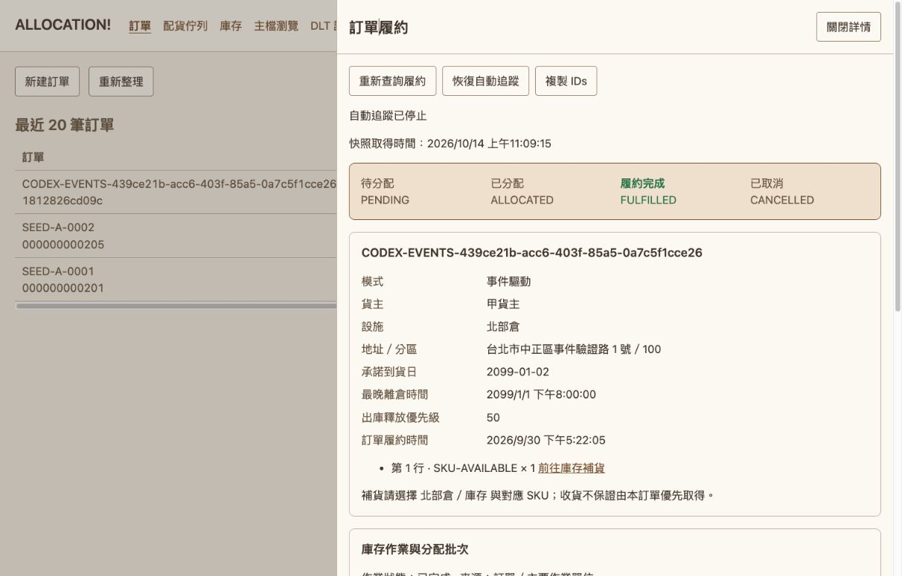
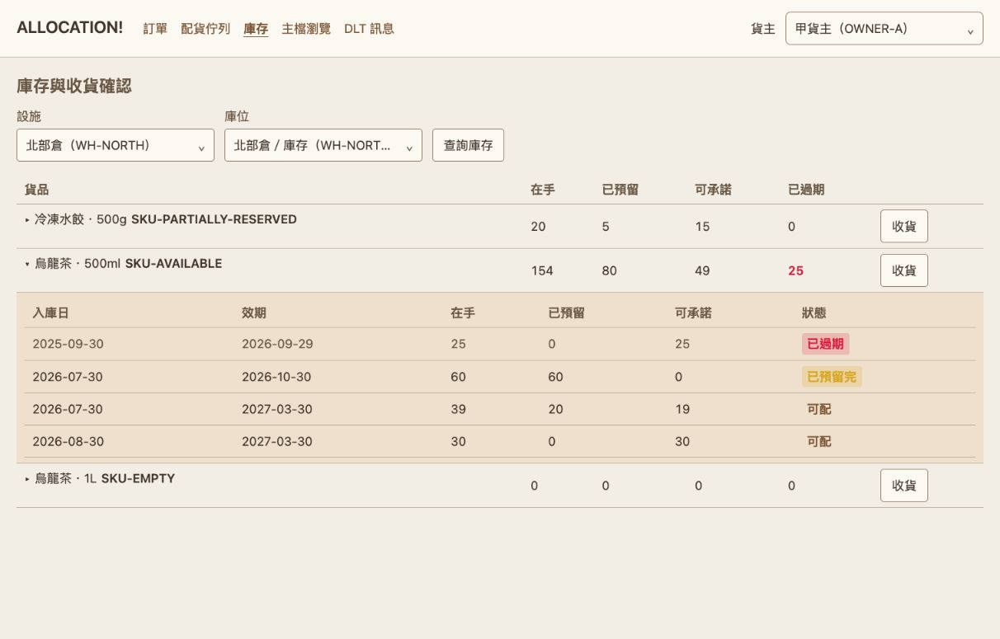

# Archone

以訂單配貨為核心的物流系統，串接庫存、倉儲出貨與履約追蹤。
從建立訂單、缺貨等待、補貨，到交運與完成出庫，都能透過 **ALLOCATION! 操作台**查看進度。

[快速啟動](#快速啟動) · [操作畫面](#操作畫面) · [開發與部署](#開發與部署) · [文件首頁](docs/README.md)

## 快速啟動

準備 Docker 與 Docker Compose v2，在 repository root 執行：

```bash
make demo-up MODE=events
```

看到「簡報環境已就緒」後，開啟 **[http://localhost:28695](http://localhost:28695)**。
前後端與示範資料會在容器中啟動，主機不需安裝 Java 或 Node.js；首次啟動需下載依賴。

```bash
make demo-down MODE=events     # 停止，保留資料
make demo-up MODE=temporal     # 另一組環境：http://localhost:28795
```

連接埠、日誌、重建與常見問題見[示範系統操作指南](docs/operations/demo.md)。

## 操作畫面

以下為本機 Events demo 的實際畫面。
操作台提供訂單、配貨佇列、庫存、主檔瀏覽與 DLT 訊息五個頁面。

### 訂單與履約

建立訂單後，從詳情追蹤庫存作業、批次與出貨狀態。



### 庫存與批次

依貨主、倉別與庫位查詢庫存，查看各批次數量並進行收貨。



操作步驟與功能限制見[操作指南](docs/operations/demo.md#操作台能做什麼)。

## 架構概覽

同一組 bounded contexts 提供兩種部署組裝：

| 組裝 | 支援的履約模式 | 現況 |
| --- | --- | --- |
| Monolith | Events、Temporal | 單一應用程式；提供含前端的 demo |
| Microservice | Events | 五個獨立服務；目前共用 PostgreSQL schema |

Events 由事件推進履約；Temporal 透過 Workflow／Activity 協調相同業務流程，仍使用 Kafka／Outbox 傳遞事件。
進一步閱讀[系統架構](docs/architecture/c4-model.md)、[Context map](docs/ddd/context-map.md)與[履約流程](docs/architecture/fulfillment-orchestration.md)。

## 開發與部署

| 想做什麼 | 文件 |
| --- | --- |
| 在主機或 IDE 開發前後端 | [本機開發與環境需求](docs/development/local-development.md) |
| 執行 unit tests、SIT、E2E 或格式檢查 | [測試與檢查](docs/development/testing.md) |
| 打包 Monolith 或啟動五個 Microservices | [打包與部署](docs/operations/deployment.md) |
| 調整 schema 或處理既有資料庫 | [資料庫 migration](database/README.md) |
| 排查訊息處理與重送 | [Messaging 維運](docs/operations/messaging.md) |
| 了解設計理由與邊界 | [完整文件地圖](docs/README.md) |

## 專案目錄

| 目錄 | 內容 |
| --- | --- |
| [`backend/`](backend/README.md) | Java／Spring Boot 模組與部署組裝 |
| [`frontend/`](frontend/README.md) | React 操作台與前端開發設定 |
| [`database/`](database/README.md) | 共用 SQL migrations 與 Flyway runner |
| [`docker/`](docker/README.md) | Compose 組裝與環境設定 |
| [`e2e/`](e2e/) | 正確性與效能測試 |
| [`docs/`](docs/README.md) | 開發、操作、架構與設計決策 |
| [`scripts/`](scripts/) | 啟動、migration 與 connector 初始化腳本 |
