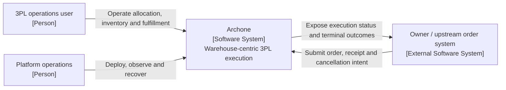
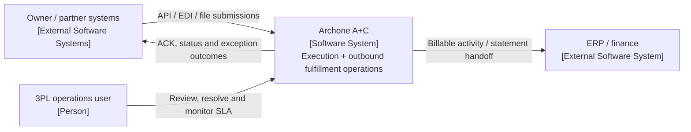
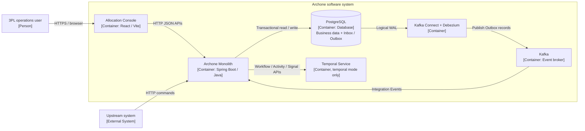
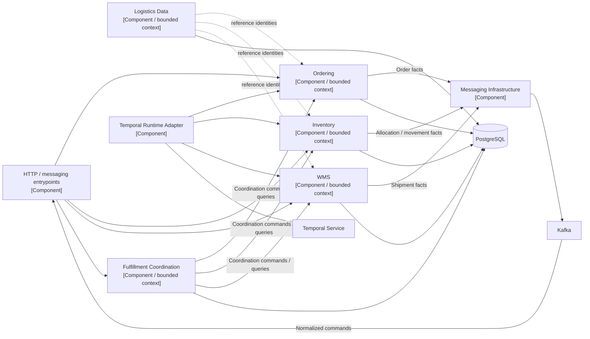
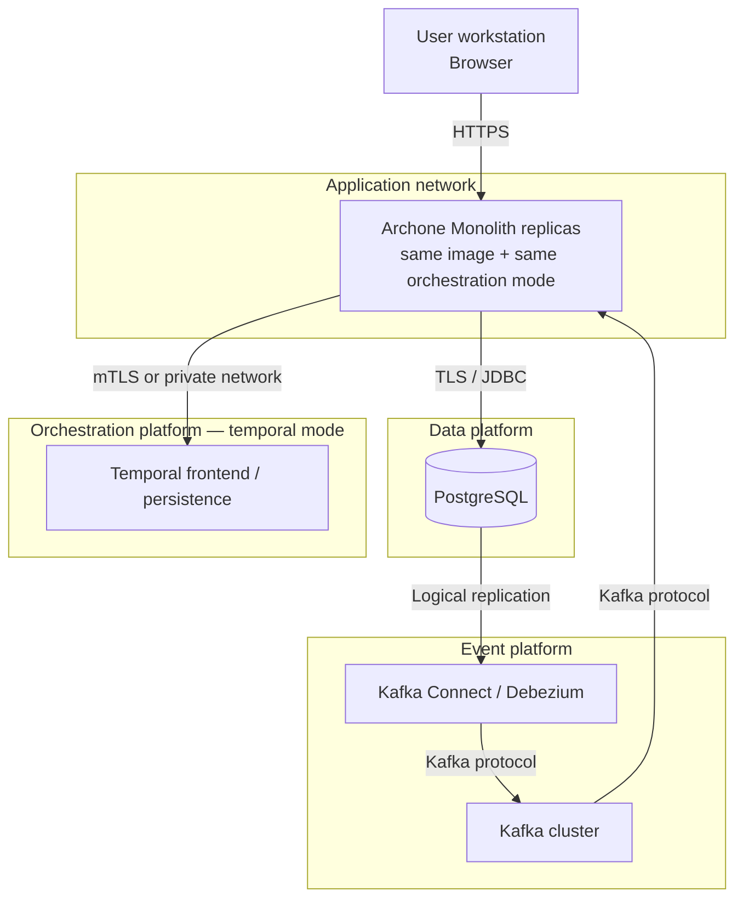

# Archone C4 Model

更新日期：2026-09-26

本文件以 C4 的抽象層級呈現 Archone 的 Current runtime 與 Target 邊界。圖中的 `Container` 是可執行程式、process
或 data store；Ordering、Inventory、WMS 等 bounded context 目前同在 monolith，因此在 C4 中是 Component，
不是獨立 Container。

## Scope and notation

- `Current` 只描述 repository、deployment files 與 tests 已存在的結構。
- `Target` 只描述已接受的演進方向，不代表 module、API 或 deployment 已存在。
- 圖只保存穩定邊界與重要 dependency；class、adapter、topic 清單由程式碼、contract tests 與 Graphify 導航。
- C4 說明結構；跨 context ownership 與業務語意仍以 [Context map](../ddd/context-map.md) 為準。

## Level 1：Current system context

Current scope begins after upstream has selected Owner and Facility. Archone owns inventory commitment, warehouse execution facts
and their coordination; it does not currently own sourcing, multi-facility routing, commercial splitting or promise decisions.

## Level 1：Target ecosystem

Target 增加 Partner Integration／ACL、Operational Service Policy、Outbound Fulfillment Operations、Control Tower 與
3PL Billing，但仍不自動取得 OMS／DOM 權責。Target logical component 是否需要獨立 deployable，屬於
[OPEN-006](../ddd/decisions.md#open尚待決定)。

## Level 2：Current containers

重要限制：

- `events` 與 `temporal` 是 deployment-wide 互斥 mode；Temporal mode 仍使用 Kafka／Outbox 傳遞 canonical facts。
- PostgreSQL transaction 同時提交 business state 與 Outbox；consumer transaction 同時提交 Inbox、business effect
  與 follow-up Outbox。
- stage／prod 的 PostgreSQL、Kafka、Kafka Connect／Debezium 與 Temporal 由部署平台提供，不由 application
  container 動態建立。

## Level 3：Current monolith components

Component 間只能經公開 application boundary 或 versioned Integration Event 合作；共用 process 與 database
不授權直接讀取其他 context 的 internal table 或 domain model。架構測試保護 package／dependency direction，
integration tests 保護 wiring 與 transaction boundary。

## Target logical components

| Component | Target responsibility | Current status | Container decision |
| --- | --- | --- | --- |
| Partner Integration／ACL | Partner protocol、identity、deduplication、ACK 與 submission normalization | `Not started` | Open；不可因 logical boundary 預建 service |
| Operational Service Policy | Versioned Owner profile、硬條件與 effective dating | `Not started` | [OPEN-002](../ddd/decisions.md#open尚待決定) |
| Outbound Fulfillment Operations | Submission review、FulfillmentCase、milestone、SLA 與重大例外 | `Partial`：已有 coordination | 先在現行 Fulfillment boundary 演進 |
| Control Tower | Read-only projection、timeline、alert 與 work entry | `Not started` | 初期不是 system of record |
| 3PL Billing | Billable activity、rate card、rating、adjustment 與 statement | `Not started` | Target 為獨立 bounded context；ERP 保留總帳 |
| Returns | Reverse-flow case 與 Inventory disposition coordination | `Not started` | 先為 capability，達升格條件後再定 deployment |

## Deployment view

- 所有 replicas 必須使用同一 orchestration mode；不能以混合 Events／Temporal pods 的 rolling update 切換。
- Management endpoint 只應位於 private platform network；現行 application 不提供 endpoint security。
- Backup／restore、TLS、credentials rotation、Kafka topic、connector 與 Temporal production durability 是部署平台責任。
- Production SLO、RTO、RPO、replica 數與容量門檻尚未定案，記錄於
  [Quality attributes](quality-attributes.md)，不得從本圖推論。

## Evidence and update triggers

| View | Evidence |
| --- | --- |
| System boundary | [3PL 策略](../ddd/strategy.md)、[Context map](../ddd/context-map.md) |
| Containers／deployment | `Dockerfile`、`docker/compose*.yml`、[`docker/README.md`](../../docker/README.md) |
| Components | `backend/settings.gradle`、module source sets、architecture tests |
| Messaging path | [Messaging 維運](../operations/messaging.md)、Outbox／Inbox integration tests |
| Dual orchestration | [Fulfillment orchestration](fulfillment-orchestration.md)、dual-mode E2E scenarios |

新增 deployable、database、external system、trust boundary 或 bounded-context ownership 時必須更新相應 view；單純
class／package refactor 不應造成 C4 圖變動。
