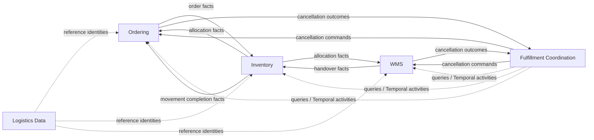

# Context Map

更新日期：2026-09-26

## Current bounded contexts

| Context | 擁有的事實 | 主要實作 |
| --- | --- | --- |
| Ordering | `Order`、`OrderLine` 與 order lifecycle | `backend/ordering` |
| Inventory | stock operation／move、allocation、reservation、quant 與 location | `backend/inventory` |
| WMS | Shipment、Wave、Picking、Dispatch 與 Receiving execution | `backend/wms` |
| Logistics Data | Owner、Product、SKU 與 Facility reference data | `backend/logistics-data-context` |
| Fulfillment Coordination | 跨 context 履約查詢、Events cancellation process 與 Temporal workflow coordination | `backend/fulfillment`、`backend/orchestration-temporal-*` |

`integration-contracts`、`archone-framework` 與 `deployments:monolith` 分別是 published contracts、技術能力與部署
組裝，不是 bounded context。同一 process 部署也不表示 context 可以繞過 application boundary 共用 domain model。

Inventory 與 WMS 內的 package 是內部 domain module；package 分割本身不構成新的 bounded context。

## Current relationships

| Upstream → Downstream | 合作方式 | 邊界語意 |
| --- | --- | --- |
| Ordering → Inventory | Published Language | 已受理 Order 成為 source-neutral movement intent |
| Inventory → Ordering | Published Language | committed allocation 與 completed outbound movement |
| Inventory → WMS | Customer–Supplier | committed assignment snapshot 成為 Shipment input |
| WMS → Inventory | Published Language | handover 使 Inventory 可以完成 outbound movement |
| Fulfillment → WMS／Ordering | Process Manager | Events commands 或 Temporal Activities；兩種 driver 委派相同 use cases |
| WMS／Ordering → Fulfillment | Process feedback | outcome events 或 Temporal Signals；Fulfillment 只擁有協調狀態 |
| Logistics Data → consumers | Reference data | 共享 identity／read model，不共享 persistence ownership |

## Context ownership

### Ordering

管理 Order identity 與生命週期，記錄 allocation、fulfillment、cancellation 對 Order 的結果。它不計算 ATP、
不擁有批次承諾，也不解讀 WMS 內部進度。

### Inventory

把來源需求轉成 movement intent，規劃並原子提交庫存承諾，維持位置數量與 movement lifecycle。它不擁有 Order、
Shipment 或商品主檔生命週期。詳細規則見 [Inventory 架構](../architecture/inventory.md)。

### WMS

把已承諾需求轉成可執行的倉內工作，直到 handover；也管理 receiving execution。它不決定 Order 是否 fulfilled，
也不擁有 `StockQuant`。

### Fulfillment Coordination

現行能力是跨 context 查詢、取消 process manager 與 Temporal workflow。它不複製 Order、StockOperation、Shipment
狀態；workflow phase 只是 checkpoint。目標演進見[策略](strategy.md)與
[Fulfillment orchestration](../architecture/fulfillment-orchestration.md)。

## Target additions

Target context map 增加下列邊界，但尚未全部實作：

- Partner Integration／ACL 將 Owner-specific protocol 正規化成 submission command。
- Operational Service Policy 提供版本化 service profile 與硬條件。
- Outbound Fulfillment Operations 完成受理、Case、SLA、取消與 exception coordination。
- Control Tower 讀取各 context facts 建立 projection 與工作入口，不回寫來源 aggregate truth。
- 3PL Billing 由不可變作業事實產生 billable activity，交由外部 ERP 開票與入帳。
- Returns 以獨立 capability 協調 WMS receiving 與 Inventory disposition，不重開原 FulfillmentCase。

## Boundary rules

1. Domain／Application business code 不依賴 versioned Integration Event contract 或 transport infrastructure。
2. Outbound publication 走 `Application Event → Publisher port → Integration Event Adapter`，並留在原 business
   transaction。
3. Consumer 只把 versioned contract 與 correlation identity 轉成 normalized command，再交給 use case。
4. Context 間不得以共享 database entity 或讀取對方 internal table 取代 published boundary。
5. Temporal Activity 傳遞 command；canonical result 由 owner context 透過自己的 transaction 與 event 發布。
6. Tenant 是 3PL provider；`ownerId` 是 tenant 內 ACL、庫存、政策與計費的強制範圍。
7. Control Tower、報表與查詢 projection 可以組合資料，但不能因此取得來源狀態的寫入權。
