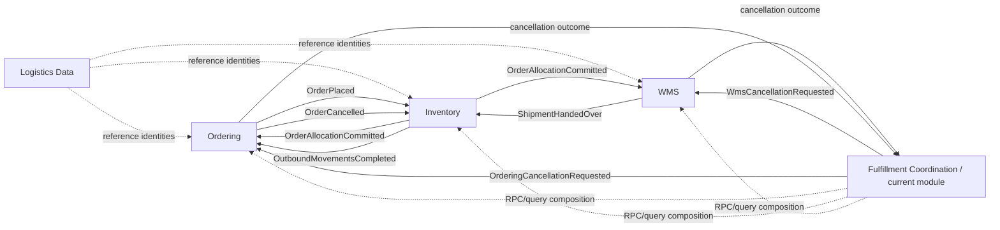
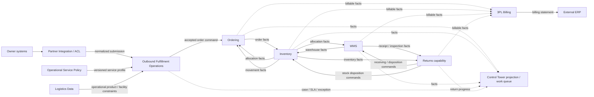

# Context Map

狀態：AS-IS 關係＋TO-BE 已決策方向

## AS-IS 關係圖

## TO-BE 關係圖

## 合作關係

| Upstream → Downstream | 關係草案 | Published language / contract | 備註 |
| --- | --- | --- | --- |
| Ordering → Inventory | Customer–Supplier | `OrderPlacedIntegrationEvent` | Inventory 將 order identity 正規化成 movement demand |
| Inventory → Ordering | Open Host Service + Published Language | `OrderAllocationCommittedIntegrationEvent`、`OutboundMovementsCompletedIntegrationEvent` | Ordering 不讀 Inventory domain model |
| Inventory → WMS | Customer–Supplier | `OrderAllocationCommittedIntegrationEvent` | 完整 assignment snapshot 成為 Shipment input |
| WMS → Inventory | Published Language | `ShipmentHandedOverIntegrationEvent` | Inventory 以 correlation 與 movement proof 完成出庫 |
| Ordering → Inventory | Published Language | `OrderCancelledIntegrationEvent` | Inventory 釋放 source movements |
| Outbound Fulfillment → WMS / Ordering | Process Manager | cancel command events 或 Temporal Activities | driver 互斥，但委派相同 use cases |
| WMS / Ordering → Outbound Fulfillment | Process Manager feedback | cancellation outcome events 或 Signals | Fulfillment 只擁有協調狀態 |
| Logistics Data → consumers | 待確認；傾向 Open Host Service | 目前為 REST/read model 與 shared identifiers | 需避免共享 persistence model |

## TO-BE 新增關係

| Upstream → Downstream | 關係 | Published language / boundary | 邊界規則 |
| --- | --- | --- | --- |
| Owner systems → Partner Integration | Anti-Corruption Layer | Owner-specific API／EDI／file | 只處理 protocol、identity、mapping、dedupe 與 ACK |
| Partner Integration → Outbound Fulfillment | Conformist to canonical intake | normalized submission command | Fulfillment 才做 semantic validation 與受理決策 |
| Operational Service Policy → Outbound Fulfillment | Open Host Service + snapshot | versioned service profile | 核准時快照，硬條件在建單前重驗 |
| Logistics Data → Outbound Fulfillment／WMS／Inventory | Open Host Service | operational product and facility profile | 商業 Product Master 仍由 Owner ERP 擁有 |
| Outbound Fulfillment → Ordering | Customer–Supplier | accepted-order command | 未核准 submission 不得建立 Order 或發布 OrderPlaced |
| Operational contexts → Control Tower | Published Language / projection | case、milestone、SLA、exception views | Control Tower 不回寫來源 aggregate truth |
| Operational contexts → 3PL Billing | Published Language | immutable billable facts | Billing 依 RateCard 產生 activity／adjustment |
| 3PL Billing → external ERP | Anti-Corruption Layer | billing statement/export | ERP 擁有 invoice、AR、payment、ledger |
| Returns → WMS／Inventory | Process Manager | receiving、inspection、disposition intent | ReturnCase 不重開原 FulfillmentCase |

## 重要邊界規則

1. Producer 的 Application/Domain code 不依賴 versioned Integration Event contract。
2. Integration Event consumer 只做 contract-to-command normalization，不自行編排 outbound publication。
3. 同一 business fact 面向多個 audience 時，由 Integration Event Adapter 原子轉成多筆 publication。
4. Temporal Activity 是 command delivery boundary；canonical terminal fact 仍由擁有該事實的 context 發布。
5. Modular monolith 的同 process 部署不代表可以繞過公開 application boundary。
6. Tenant 代表 3PL provider；`ownerId` 是 tenant 內的強制 ACL、庫存、政策與計費範圍。
7. Control Tower 共用 UI、SLA 元件或 workflow runtime，不構成合併 inbound、outbound、returns domain model 的理由。
8. Partner Integration consumer 只把外部 contract 正規化成 command；不得自行決定受理或直接發布後續 domain fact。

## 待確認的關係

- Logistics Data 的跨 context published contract 與 profile version propagation 方式。
- Operational Work Management 是否會形成獨立 context，或長期只作為 Control Tower application capability。
- WMS Inbound 是否會因 appointment／ASN coordination／vendor variance／detention SLA 而需要獨立 context。
- Returns 何時具備從 capability/module 升格 Returns Management bounded context 的條件。
