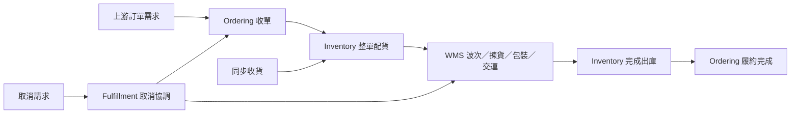
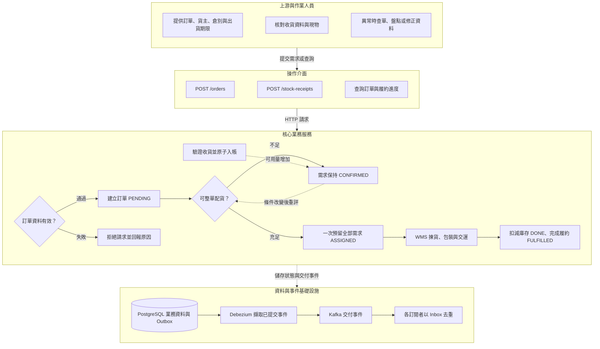
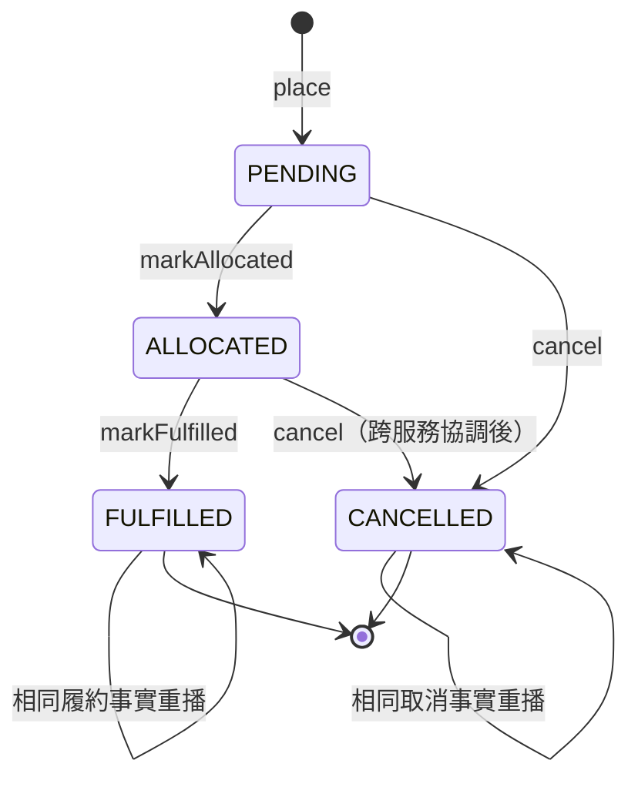
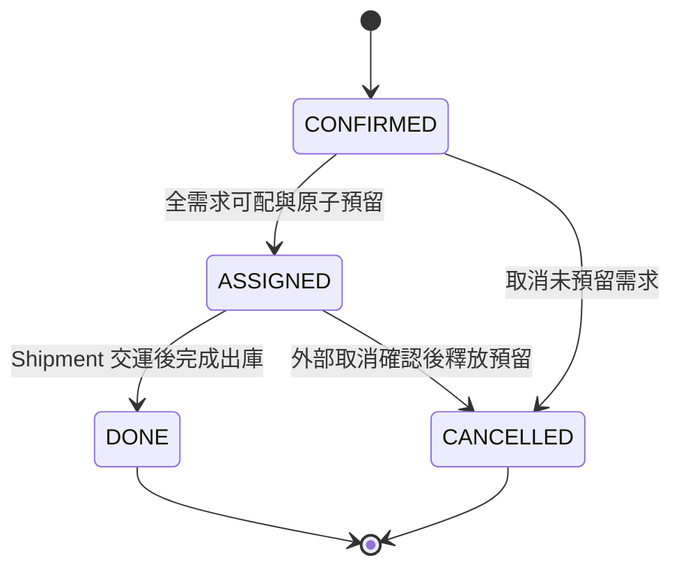

# 01｜業務流程與系統範疇

## 1 系統目標與範疇

Archone 處理物流訂單的配貨、倉內作業與履約，支援多貨主與設施的庫存隔離。範圍不包含製造工單、BOM、機台控制或 MES。

| 商業痛點 | In-Scope：本系統職責 | Out-of-Scope：外部／人工邊界 |
| --- | --- | --- |
| 重複訂單造成重複履約 | `(owner_id, external_order_no)` 唯一性；重複回 409 | ERP 單號編配、接單審核、財務與發票 |
| 貨主或庫位混用 | 貨主、SKU、設施授權關係、內部庫位與批次隔離 | 自動選倉、跨倉調撥 UI、主檔維護與授權流程 |
| 有部分庫存卻無法整單出貨 | `SHIP_COMPLETE`：全需求滿足才預留；相同 SKU 多行需求加總 | 拆單、部分承諾、替代料、人工超賣 |
| 效期與需求排序不一致 | FEFO 選批；`FIFO`／`DISPATCH_DATE_FIRST` 排序，後者為預設 | 上游承運時效與工作日曆；`dispatchBy` 由呼叫方提供 |
| 補貨後等待單未處理 | `StockAvailabilityIncreased` 事件喚醒，加上定期 reconciliation | 供應商採購、設備收貨協議、條碼辨識 |
| 離倉前取消與出貨競爭 | 先確認 WMS 可取消，再取消 Ordering，最後釋放 Inventory | 已交運後退貨、逆物流、人工帳務補償 |
| 查不到流程中斷點 | 訂單、庫存作業、Shipment、取消 process 與事件追蹤 | 既定 SLA、告警值、正式環境容量保證，需部署方驗證 |

| 部署與驅動 | 現況 |
| --- | --- |
| Monolith | 支援 `events` 與 `temporal` |
| Microservice | 五服務 Events 組裝，目前共用 PostgreSQL schema |
| WMS 執行 | 預設由模擬排程推進倉內作業；尚未串接實體條碼槍或承運商 |
| 主檔 | REST 只提供查詢；示範資料由 seed／fixture 建立 |

## 2 跨系統泳道流程

由上而下依序為人員、操作介面、核心服務與資料基礎設施。下方基礎設施支援所有業務步驟；圖中的分層位置不表示資料庫只在履約結束後才寫入。實際交易與非同步交付時序見 [整合與交易時序](06_INTEGRATION_AND_SEQUENCE.md)。

完整流程圖見 [02 BPMN 流程圖集](02_BPMN_PROCESS_MODELS.md)。

### 2-1 角色權責

R＝執行、A＝最終負責、C＝協作、I＝知會。此表為作業分工，不代表系統帳號權限。

| 作業 | 生管／業務 | 倉庫作業員 | 系統開發／SA | 維運／DBA | 上游系統負責人 |
| --- | --- | --- | --- | --- | --- |
| 提供訂單、出貨期限、優先級 | A | I | C | I | R |
| 收貨資料與現物核對 | A | R | C | I | C |
| 配貨與狀態規則維護 | A | C | R | C | I |
| 離倉前取消與現物攔截 | A | R | C | C | I |
| 訊息延遲、DLT、資料不一致調查 | I | C | R | A | C |

### 2-2 線下異常處置矩陣

| 異常 | 人工步驟 | 恢復條件 |
| --- | --- | --- |
| 下單逾時、結果未知 | 保存原請求與 `externalOrderNo`；查訂單與日誌；不要換單號再次下單 | 找到唯一訂單，或確認原交易未成立後由同一單號重送 |
| 缺貨 | 核對 `ownerId`、`locationId`、效期與預留量；依實際收貨提交固定 `receiptId` | 全單所有 SKU 足夠，配貨事件或 reconciliation 推進 |
| 取消受理但未完成 | 保存 `effectiveRequestId`；Events 查 process，核對 WMS 現物是否已交運 | Order、StockOperation、Shipment 與預留量一致；202 本身不表示完成 |
| 已交運卻要求取消 | 告知業務取消不可逆轉交運；交由外部退貨流程 | 不以直接改 DB 狀態替代逆物流 |

## 3 核心生命週期

### 3-1 訂單狀態

| 目前狀態 | 觸發行為 | 成立條件 | 目標狀態 | 系統處置 | 異常攔截代碼／結果 |
| --- | --- | --- | --- | --- | --- |
| 尚未建立 | `place` | 至少一行、數量正整數、必要主檔 FK、優先級 0–100 | `PENDING` | 產生 ID、`receivedAt`，同交易保存 Order 與事件 | 400 validation／`INVALID_REQUEST`／`DATA_INTEGRITY_VIOLATION`；重複單號 409 `DATA_CONFLICT` |
| `PENDING` | `markAllocated` | 完整配貨結果；`allocatedAt >= receivedAt` | `ALLOCATED` | 記錄配貨時間 | 內部錯誤為 `IllegalStateException` 或 `IllegalArgumentException`；事件失敗無 HTTP 回應 |
| `ALLOCATED` | `markFulfilled` | 出庫已完成、Shipment ID 存在、時間不早於配貨 | `FULFILLED` | 保存 Shipment correlation 與完成時間 | 衝突事實 `ORDER_FULFILLMENT_CONFLICT`；事件通道無 HTTP code |
| `FULFILLED` | 相同 `markFulfilled` | Shipment 與完成時間完全一致 | `FULFILLED` | 回 `false`，不重複修改 | 不同事實為 `ORDER_FULFILLMENT_CONFLICT` |
| `PENDING`／`ALLOCATED` | `cancel` | WMS 協調先行；requestId、1–512 字 reason；取消時間不早於收單／配貨 | `CANCELLED` | 保存取消 identity，發布取消事件供釋放庫存 | 不合法命令 `INVALID_REQUEST`；跨服務失敗由 process 表示 |
| `CANCELLED` | 相同 `cancel` | requestId、時間與 reason 完全一致 | `CANCELLED` | 回 `ALREADY_CANCELLED` | 不同事實 `ORDER_CANCELLATION_REQUEST_CONFLICT` |
| `FULFILLED` | `cancel` | 終態禁止逆轉 | 不變 | 回 `REJECTED` | Events API 可先 202、稍後 process `REJECTED`；不是立即保證 HTTP 409 |

### 3-2 庫存與倉儲狀態

| 庫存／倉儲事實 | 說明與防呆 |
| --- | --- |
| StockOperation 與 StockMove | 均使用 `CONFIRMED / ASSIGNED / DONE / CANCELLED`；同 operation 的 moves 狀態須一致 |
| 預留與實扣 | `ASSIGNED` 增加 reserved；交運後 `DONE` 扣減 on-hand 並結清 reserved；取消釋放預留，不能當成已出庫退貨 |
| 一段式收貨 | 在同一交易建立並完成 inbound operation／move／批次，增加 on-hand；不等待 outbound 配貨完成才回應 |
| Shipment 正常路徑 | `CREATED → WAVE_PLANNED → RELEASED → PICKING → PICKED → PACKED → READY_FOR_DISPATCH → HANDED_OVER_TO_CARRIER`；實作也允許 `RELEASED → PICKED` |
| Shipment 取消 | 尚未交運時可能直接 `CANCELLED`，或經 `CANCELLING` 等待倉內確認；交運後拒絕 |
| 缺貨 | 維持 `PENDING`／`CONFIRMED`；沒有自行新增的 `SHORTAGE` 或 `FAILED` 狀態 |
