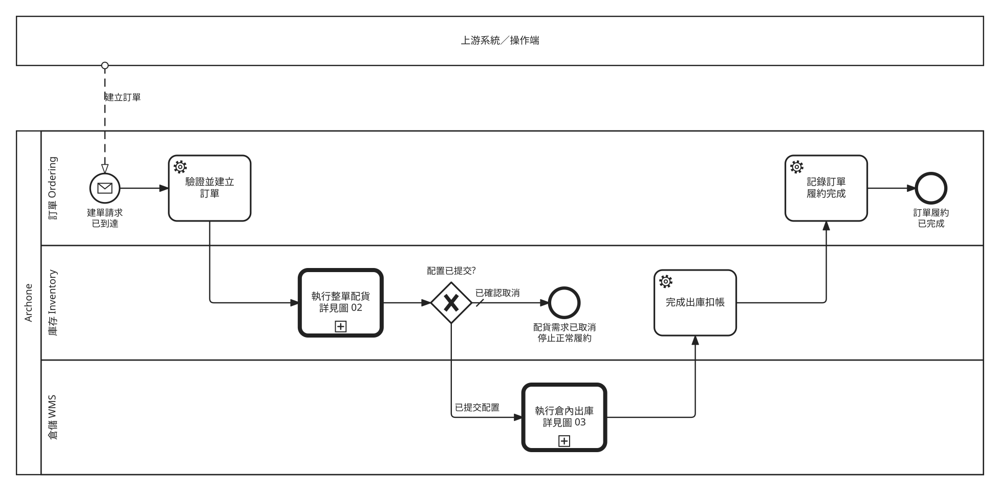
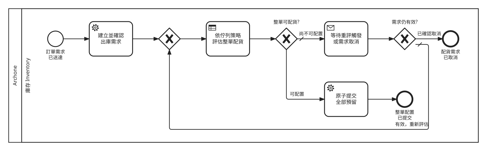
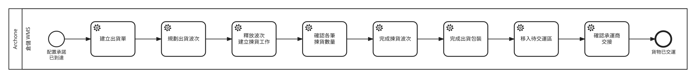
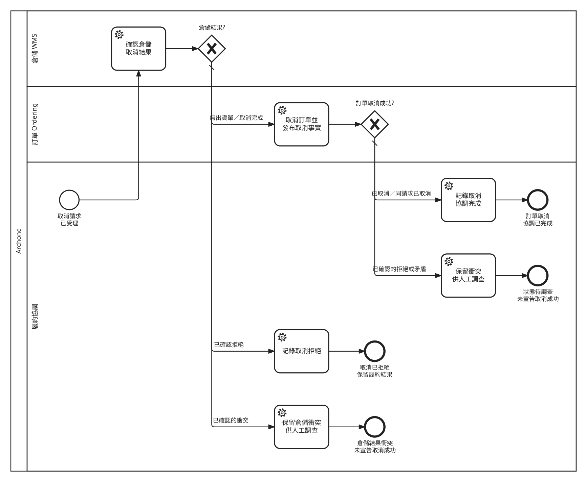
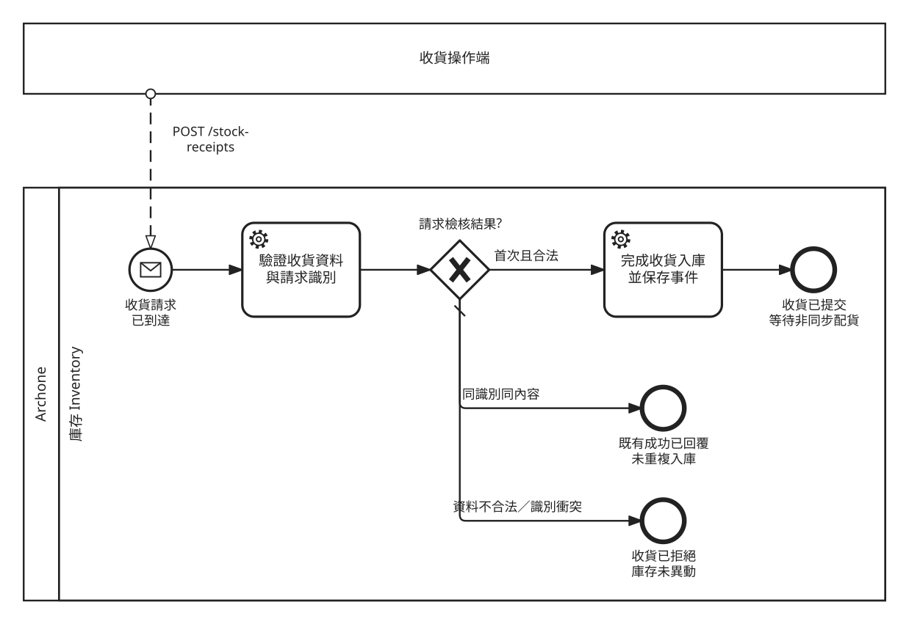
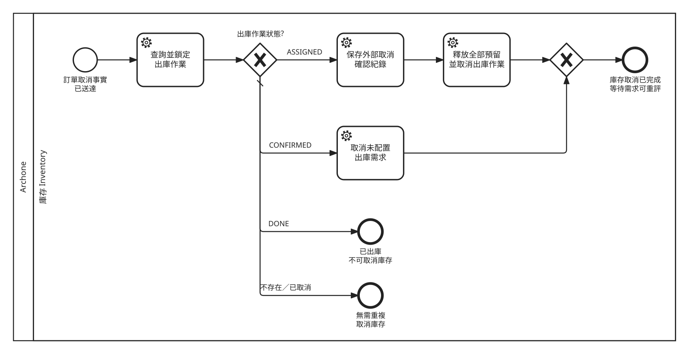

# 02｜BPMN 流程圖集

## 1 業務流程

### 1-1 訂單履約總覽

從訂單建立、整單配貨與倉內出庫，到扣帳後確認履約完成。配貨需求已取消時停止主線，不繼續出貨。

[下載 BPMN](bpmn/01-fulfillment.bpmn) · [下載 PNG](bpmn/01-fulfillment.png) · [下載 SVG](bpmn/01-fulfillment.svg)

### 1-2 整單配貨與缺貨等待

依貨主策略排序需求，採 FEFO 選擇批次。全部需求均可滿足才預留；庫存不足時保留需求，等待補貨或預留釋放後重新評估。

[下載 BPMN](bpmn/02-allocation.bpmn) · [下載 PNG](bpmn/02-allocation.png) · [下載 SVG](bpmn/02-allocation.svg)

### 1-3 倉內出庫與交運

從出貨單建立，經波次、揀貨、包裝及待交運，到確認承運商交接。現有倉內步驟由模擬排程推進。

[下載 BPMN](bpmn/03-warehouse.bpmn) · [下載 PNG](bpmn/03-warehouse.png) · [下載 SVG](bpmn/03-warehouse.svg)

### 1-4 訂單取消協調

先取得倉內取消結果，再決定是否取消訂單。已交運時拒絕取消；不一致結果保留為衝突，待查明後處理。協調完成與庫存釋放完成是不同時間點。

[下載 BPMN](bpmn/04-cancellation.bpmn) · [下載 PNG](bpmn/04-cancellation.png) · [下載 SVG](bpmn/04-cancellation.svg)

### 1-5 收貨與補庫

驗證收貨資料後，在同一交易完成請求去重與庫存入帳。相同 receiptId 與相同內容重送不重複入帳；提交後再非同步評估待配貨需求。

[下載 BPMN](bpmn/05-stock-receipt.bpmn) · [下載 PNG](bpmn/05-stock-receipt.png) · [下載 SVG](bpmn/05-stock-receipt.svg)

### 1-6 取消後庫存釋放

收到訂單取消事實後，取消等待中的需求或釋放已預留數量。已完成出庫的作業不能透過取消回補庫存。

[下載 BPMN](bpmn/06-stock-cancellation.bpmn) · [下載 PNG](bpmn/06-stock-cancellation.png) · [下載 SVG](bpmn/06-stock-cancellation.svg)

## 2 圖形與閱讀方式

| 圖形 | 意義 |
| --- | --- |
| 泳池與泳道 | 泳池區分系統邊界；泳道區分 Ordering、Inventory、WMS 與 Fulfillment 的責任 |
| 圓形 | 事件的開始、等待或結束；依邊框與內部符號區分 |
| 圓角矩形 | 執行任務；齒輪為系統處理，規則符號為業務規則判斷 |
| 粗框活動 | 引用另一張流程圖 |
| 菱形 | 條件分流，依連線上的條件決定後續路徑 |
| 實線／虛線箭頭 | 實線表示流程順序，虛線表示跨泳池訊息；不代表所有步驟在同一資料庫交易 |

圖形以白底黑線呈現，顏色不承載業務含義。圖號為索引，不代表執行順序。模型供分析使用（`isExecutable=false`），實際流程由 Events／Temporal 驅動。

詳細條件與例外見 [流程規格](bpmn/process-spec.md)，模型編輯方式見 [BPMN 說明](bpmn/README.md)。

## 3 例外處理與邊界事件

現有圖集使用條件閘道與明確的結束狀態呈現業務例外，未使用附掛在活動邊框上的 Boundary Event。先前獨立的倉內取消分圖也採條件閘道，並未包含邊界事件。

| 例外情境 | 對應圖 | 現有表達方式 |
| --- | --- | --- |
| 庫存不足 | 02 整單配貨 | 保留需求、等待條件改變後重評 |
| 等待中的配貨需求已確認取消 | 01 履約、02 整單配貨 | 以判斷分支結束等待，不再推進出貨 |
| 已交運而拒絕取消、多張出貨單或跨模組結果矛盾 | 04 訂單取消協調 | 以倉內／訂單結果閘道導向拒絕或衝突終態 |
| 收貨資料無效、同識別碼但內容不同 | 05 收貨與補庫 | 驗證及去重結果分支，拒絕重複或無效入帳 |
| 已完成出庫而不可取消 | 06 取消後庫存釋放 | 狀態分支導向不可取消，不逆轉出庫 |
| 訊息處理失敗、網路或資料庫暫時故障 | [06 整合與交易時序](06_INTEGRATION_AND_SEQUENCE.md) | 交易回滾、技術重試及 DLT 處理；六張業務圖未展開此機制 |

Boundary Event 用來描述活動執行中發生事件時的轉向；Error Boundary Event 會中斷其附掛活動。這與活動回傳結果後的條件判斷不同。若要補畫，須先定義附掛活動、事件條件及處置路徑。現有需求未定義缺貨逾時自動取消，因此未加入此類 Timer Boundary Event。[BPMN 事件語意](https://docs.camunda.io/docs/8.9/components/modeler/bpmn/events/)
