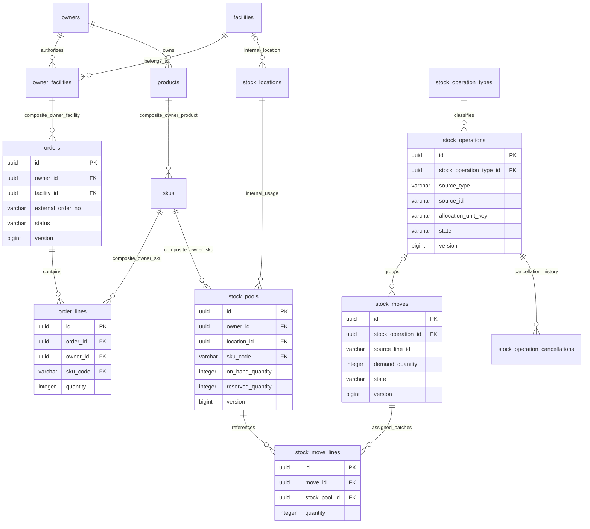
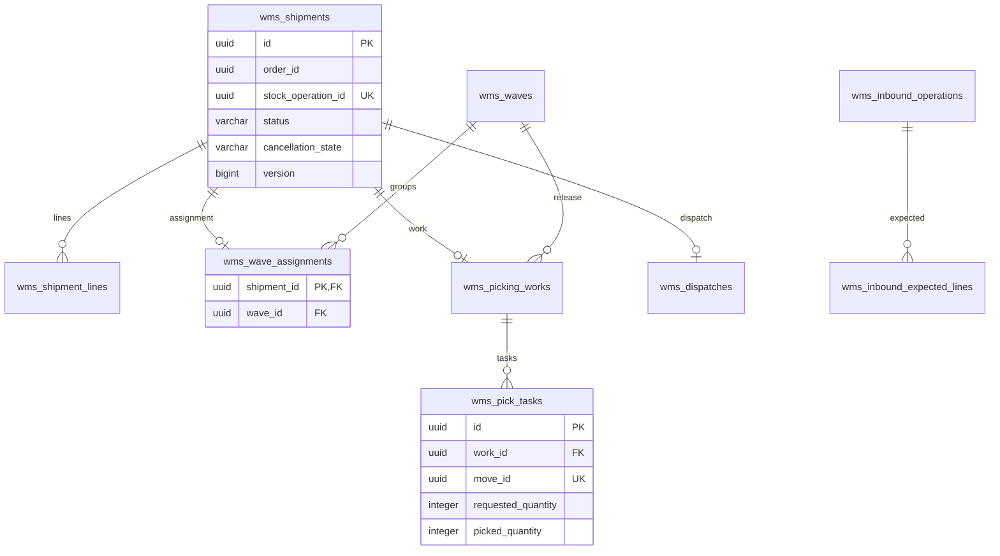
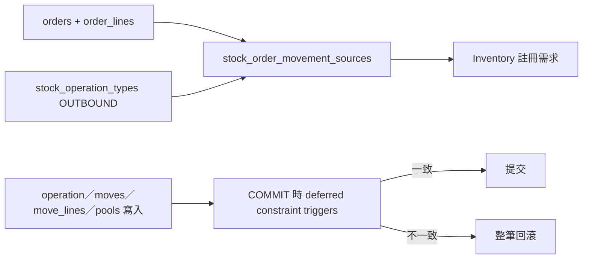
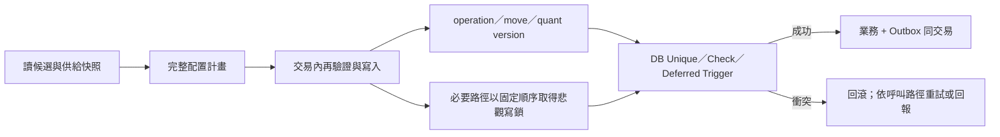

# 03｜資料模型、儲存與並行控制

## 1 實體關係

### 1-1 訂單與庫存

| 關聯讀法 | 意義 |
| --- | --- |
| 圖中實線 | 已存在 DB FK；此圖選取核心關聯，完整 FK 見 [資料字典](04_DATA_DICTIONARY.md) 各表約束 |
| `stock_moves.stock_operation_id` | SQL 允許 NULL，圖中標 optional parent；不能因現行流程通常有值而改為 NOT NULL |
| 跨 context correlation | `stock_operations.source_id`、`wms_shipments.order_id`、`wms_shipments.stock_operation_id`、`orders.fulfilled_by_shipment_id`、`cancellation_processes.order_id` 沒有相應跨 context DB FK；不能在 ERD 冒稱有實體 FK |
| 批次唯一身分 | owner + location + SKU + in_date + expiry_date；相同 SKU 在不同貨主或庫位完全分開 |
| 可承諾量 | Domain／API 的 `availableToPromise` 為 `on_hand_quantity - reserved_quantity`，過期批也保留此差額；配貨 SQL 另以 `expiry_date >= today` 排除過期批。讀取端須同看 `expired`，不存第三個可變餘額 |

### 1-2 倉內作業

| WMS 資料責任 | 說明 |
| --- | --- |
| 實體外鍵 | assignments、works、tasks、dispatches 有 WMS 內部 FK；`wms_shipments.wave_id` 本身未定義 FK |
| WMS 與 Inventory | Shipment 保存 move／order line correlation，實際庫存餘額由 Inventory 管理 |
| Inbound 模型 | 有 WMS inbound 與 expected lines 資料模型；`POST /stock-receipts` 的同步 Inventory 收貨流程不等同完整 WMS inbound 作業介面 |

## 2 資料責任與命名對照

| 資料群 | 資料維護責任 | 跨系統來源 |
| --- | --- | --- |
| owners、products、skus、facilities、owner_facilities | Logistics Data 主檔；現有讀 API，seed／fixture 初始化 | 貨主與商品識別資料，不包含本次未實作的 ERP 同步 |
| stock_locations、stock_operation_types | Inventory 庫位與作業配置 | facility 身分引用主檔 |
| orders、order_lines | Ordering | externalOrderNo、shipTo、promisedDeliveryDate、dispatchBy、releasePriority、placedAt 由上游提供；receivedAt 由系統產生 |
| stock_pools、stock_operations、stock_moves、stock_move_lines | Inventory | 訂單需求由 `stock_order_movement_sources` view 讀取；收貨由 receipt command 提供 |
| owner_allocation_policies | Inventory 配貨設定 | 缺省使用 `DISPATCH_DATE_FIRST` |
| stock_receipt_requests、stock_operation_cancellations | Inventory 冪等與取消協調紀錄 | receiptId／取消 correlation 由呼叫端或流程傳入 |
| wms_* | WMS 倉內執行 | 已配貨事實建立 Shipment；simulation driver 現行自動推進 |
| cancellation_processes | Fulfillment（Events 模式） | 外部不可變 request、WMS 與 Ordering outcome |
| event_outbox、event_inbox | 共用 messaging infrastructure | publication／subscriber 消費事實；不是另一份可人工編輯的業務狀態 |

## 3 View、跨表規則與狀態防呆

View 的逐欄型別與來源見 [資料字典：stock_order_movement_sources](04_DATA_DICTIONARY.md#stock_order_movement_sources)。

`stock_order_movement_sources` 是普通 view，僅排除 `orders.cancelled_at IS NOT NULL` 的訂單，不是另一個儲存的需求狀態，也沒有自帶 PK／索引。

| 防呆條件 | 實作位置 | 失敗處置 |
| --- | --- | --- |
| operation 至少一個 move，所有 move state 與 operation 一致 | 作業一致性延遲約束 | deferred constraint trigger 在交易結束時拋 `check_violation` |
| CONFIRMED／CANCELLED 不可有 move lines；ASSIGNED／DONE 的 line 總量等於 demand | 同上 | 整筆交易回滾 |
| pool.reserved = 引用該批的 ASSIGNED move lines 數量加總 | 預留守恆延遲約束 | 整筆回滾，不能只改 pool 數字 |
| reserved 介於 0 與 on-hand | 庫存批次 CHECK 與餘額規則 | DB CHECK 或領域檢核拒絕 |
| 取消／履約時間與 correlation 合法 | 訂單狀態規則與部分資料庫關聯 CHECK | Domain 拒絕；不可假設 DB 已限制 orders.status 全部列舉 |
| WMS state 與取消 metadata 一致 | 資料庫 CHECK 與出貨單狀態規則 | 無效 status／timestamps 回滾 |
| SQL nullable 與 CHECK | PostgreSQL CHECK 允許 UNKNOWN | 字典保持實際 NULL 宣告；有語意限制的欄位不因此變成 NOT NULL |

## 4 既有索引與查詢對齊

下表列出資料庫顯式索引；主鍵（PK）與唯一約束（UNIQUE）也會建立索引。

| 索引定義 | 所屬資料表 |
| --- | --- |
| `CREATE INDEX idx_skus_product ON skus (owner_id, product_code);` | `skus` |
| `CREATE INDEX idx_orders_recent ON orders (received_at DESC, id DESC);` | `orders` |
| `CREATE UNIQUE INDEX uq_orders_cancellation_request ON orders (cancellation_request_id) WHERE (cancellation_request_id IS NOT NULL);` | `orders` |
| `CREATE UNIQUE INDEX uq_orders_fulfilled_shipment ON orders (fulfilled_by_shipment_id) WHERE (fulfilled_by_shipment_id IS NOT NULL);` | `orders` |
| `CREATE INDEX idx_order_lines_demand_fifo ON order_lines (owner_id, sku_code, order_id);` | `order_lines` |
| `CREATE INDEX idx_stock_pools_fefo ON stock_pools (owner_id, location_id, sku_code, expiry_date, in_date, id);` | `stock_pools` |
| `CREATE INDEX idx_stock_operations_confirmed_scope_queue ON stock_operations (owner_id, from_location_id, enqueued_at, id) WHERE (((state)::TEXT = 'CONFIRMED'::TEXT) AND ((direction)::TEXT = 'OUTBOUND'::TEXT));` | `stock_operations` |
| `CREATE INDEX idx_stock_operations_dispatch_sequence ON stock_operations (owner_id, from_location_id, dispatch_by, enqueued_at, id) WHERE (((state)::TEXT = 'CONFIRMED'::TEXT) AND ((direction)::TEXT = 'OUTBOUND'::TEXT));` | `stock_operations` |
| `CREATE UNIQUE INDEX uq_stock_operations_source_unit ON stock_operations (source_type, source_id, allocation_unit_key) WHERE (source_type IS NOT NULL);` | `stock_operations` |
| `CREATE INDEX idx_stock_moves_confirmed_operation_sku ON stock_moves (stock_operation_id, sku_code) WHERE ((state)::TEXT = 'CONFIRMED'::TEXT);` | `stock_moves` |
| `CREATE INDEX idx_stock_moves_confirmed_scope_sku ON stock_moves (owner_id, from_location_id, sku_code, stock_operation_id) WHERE ((state)::TEXT = 'CONFIRMED'::TEXT);` | `stock_moves` |
| `CREATE INDEX idx_stock_moves_operation_ordered ON stock_moves (stock_operation_id, line_sequence, id);` | `stock_moves` |
| `CREATE UNIQUE INDEX uq_stock_moves_operation_line_sequence ON stock_moves (stock_operation_id, line_sequence) WHERE (line_sequence IS NOT NULL);` | `stock_moves` |
| `CREATE UNIQUE INDEX uq_stock_moves_operation_source_line ON stock_moves (stock_operation_id, source_line_id) WHERE (source_line_id IS NOT NULL);` | `stock_moves` |
| `CREATE INDEX idx_stock_move_lines_stock_pool ON stock_move_lines (stock_pool_id);` | `stock_move_lines` |
| `CREATE INDEX idx_event_inbox_event_id ON event_inbox (event_id);` | `event_inbox` |
| `CREATE INDEX idx_event_outbox_timestamp ON event_outbox ("timestamp");` | `event_outbox` |
| `CREATE INDEX idx_wms_shipments_due_simulation ON wms_shipments (created_at, id) WHERE ((status)::TEXT = 'CREATED'::TEXT);` | `wms_shipments` |
| `CREATE INDEX idx_wms_shipments_order ON wms_shipments (order_id, created_at, id);` | `wms_shipments` |
| `CREATE INDEX idx_wms_shipments_wave_candidates ON wms_shipments (facility_id, release_priority DESC, dispatch_by, created_at, id) WHERE ((status)::TEXT = 'CREATED'::TEXT);` | `wms_shipments` |
| `CREATE INDEX idx_wms_shipment_lines_shipment ON wms_shipment_lines (shipment_id, order_line_id);` | `wms_shipment_lines` |
| `CREATE INDEX idx_wms_wave_assignments_wave ON wms_wave_assignments (wave_id, shipment_id);` | `wms_wave_assignments` |
| `CREATE INDEX idx_wms_pick_tasks_work ON wms_pick_tasks (work_id, id);` | `wms_pick_tasks` |
| `CREATE INDEX idx_wms_inbound_expected_lines_operation ON wms_inbound_expected_lines (inbound_operation_id, sku_code, id);` | `wms_inbound_expected_lines` |
| `CREATE UNIQUE INDEX ux_cancellation_process_active_order ON cancellation_processes (order_id) WHERE state IN ('WAITING_WMS', 'WAITING_ORDERING');` | `cancellation_processes` |

| 高頻查詢／用途 | 已有支援與分析 | 規劃狀態 |
| --- | --- | --- |
| owner + location + sku 的有效批 FEFO | `idx_stock_pools_fefo` 支援 scope 與 expiry_date／in_date／id；供給 SQL 另濾 `expiry_date >= today` 與可用數量 | 已存在 |
| 待配貨 FIFO／dispatch deadline queue | `idx_stock_operations_confirmed_scope_queue` 與 `idx_stock_operations_dispatch_sequence`；partial predicate 限 CONFIRMED OUTBOUND | 已存在 |
| 候選單是否包含 SKU、同 operation 行序 | `idx_stock_moves_confirmed_scope_sku`、`idx_stock_moves_operation_ordered` | 已存在 |
| WMS 波次候選 | `idx_wms_shipments_wave_candidates` 的 facility、priority DESC、dispatch_by、created_at、id | 已存在 |
| 最近訂單的 owner 篩選 | 現有 `idx_orders_recent(received_at DESC,id DESC)` 未以 owner 開頭 | 建議先 EXPLAIN ANALYZE；必要時新增 `(owner_id, received_at DESC, id DESC)`，尚未實作 |
| Inbox 保留清理 | 現有 PK 與 event_id index，沒有 processed_at index | 若啟用大量時間窗清理，再評估 `(processed_at)`；不是現有自動清理功能 |

## 5 並行寫入與隔離

| 機制 | 控制方式 | 目的／界線 |
| --- | --- | --- |
| 樂觀鎖 | 訂單、庫存作業、庫存移動、庫存批次及倉內資料使用 `version` 欄位 | 偵測 stale update；SQL DEFAULT 0 不等於所有寫入都能跳過版本檢查 |
| operation／move 悲觀鎖 | 依作業識別碼鎖定資料；明細按識別碼排序取得寫鎖 | 取消、釋放與完成等需序列化的路徑；不是所有 SELECT 都 FOR UPDATE |
| 批次全域寫入順序 | 按 SKU、效期、入庫日及批次識別碼排序取得寫鎖 | 使用 `PESSIMISTIC_WRITE`；降低多批次鎖競爭／死鎖風險 |
| 取消 process | `SELECT ... FOR UPDATE` 搭配條件更新；每次須恰好更新一筆 | 防 WMS／Ordering 重播與矛盾結果覆寫 |
| 唯一冪等 claim | receipt_id PK、process request_id PK、Inbox composite PK | 與業務 transaction 一起提交；失敗不保留半筆 claim |
| 事件 retry | 本地 optimistic + Kafka 分類重投；詳見 [整合與交易時序](06_INTEGRATION_AND_SEQUENCE.md) | 不能推論一般 HTTP request 也自動套用同一 retry policy |
