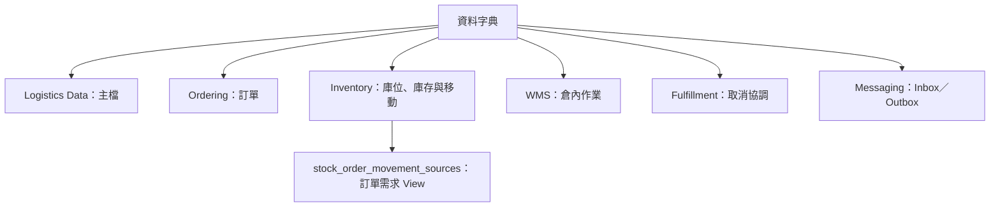

# 04｜資料字典

| 分節 | 可直接查閱的表／View |
| --- | --- |
| [Logistics Data｜主檔](#logistics-data) | [owners](#owners)、[products](#products)、[skus](#skus)、[facilities](#facilities)、[owner_facilities](#owner_facilities) |
| [Ordering｜訂單](#ordering) | [orders](#orders)、[order_lines](#order_lines) |
| [Inventory｜庫位、庫存與移動](#inventory) | [stock_locations](#stock_locations)、[stock_pools](#stock_pools)、[owner_allocation_policies](#owner_allocation_policies)、[stock_operation_types](#stock_operation_types)、[stock_operations](#stock_operations)、[stock_moves](#stock_moves)、[stock_move_lines](#stock_move_lines)、[stock_operation_cancellations](#stock_operation_cancellations)、[stock_receipt_requests](#stock_receipt_requests) |
| [WMS｜倉內作業](#wms) | [wms_shipments](#wms_shipments)、[wms_shipment_lines](#wms_shipment_lines)、[wms_waves](#wms_waves)、[wms_wave_assignments](#wms_wave_assignments)、[wms_picking_works](#wms_picking_works)、[wms_pick_tasks](#wms_pick_tasks)、[wms_dispatches](#wms_dispatches)、[wms_inbound_operations](#wms_inbound_operations)、[wms_inbound_expected_lines](#wms_inbound_expected_lines) |
| [Fulfillment｜取消協調](#fulfillment) | [cancellation_processes](#cancellation_processes) |
| [Messaging｜事件基礎設施](#messaging) | [event_inbox](#event_inbox)、[event_outbox](#event_outbox) |
| [需求來源 View](#source-view) | [stock_order_movement_sources](#stock_order_movement_sources) |

每一行是一個實體欄位。「無」表示資料庫未設定預設值；PK 隱含不可為空，複合 FK 須整組解讀。各表下方另列完整約束定義。

唯一索引名稱可能出現在欄位約束欄；完整索引 SQL 與用途見 [資料模型與儲存](03_DATA_MODEL_AND_STORAGE.md)。

## 1 Logistics Data｜主檔

### 1-1 貨主 `owners`

| 欄位 | 中文說明 | PostgreSQL 型別 | PK／FK | 允許 NULL | DEFAULT | Unique／Check／FK 約束 |
| --- | --- | --- | --- | --- | --- | --- |
| `id` | 貨主的唯一識別碼。 | `UUID` | PK | 否 | `無` | `owners_pkey` |
| `code` | 貨主代碼。 | `VARCHAR(64)` | — | 否 | `無` | `uq_owners_code` |
| `name` | 貨主名稱。 | `VARCHAR(255)` | — | 否 | `無` | — |

| 約束 | 精確定義 |
| --- | --- |
| `owners_pkey` | `PRIMARY KEY (id)` |
| `uq_owners_code` | `UNIQUE (code)` |

### 1-2 商品 `products`

| 欄位 | 中文說明 | PostgreSQL 型別 | PK／FK | 允許 NULL | DEFAULT | Unique／Check／FK 約束 |
| --- | --- | --- | --- | --- | --- | --- |
| `id` | 商品的唯一識別碼。 | `UUID` | PK | 否 | `無` | `products_pkey` |
| `owner_id` | 貨主識別碼，用於區分資料與庫存歸屬。 | `UUID` | FK | 否 | `無` | `uq_products_owner_code` `fk_products_owner` |
| `product_code` | 貨主範圍內的商品代碼。 | `VARCHAR(64)` | — | 否 | `無` | `uq_products_owner_code` |
| `name` | 商品名稱。 | `VARCHAR(255)` | — | 否 | `無` | — |
| `temperature_zone` | 商品溫層：常溫 AMBIENT、冷藏 CHILLED、冷凍 FROZEN。 | `VARCHAR(32)` | — | 否 | `無` | `ck_products_temperature_zone` |

| 約束 | 精確定義 |
| --- | --- |
| `ck_products_temperature_zone` | `CHECK (temperature_zone IN ('AMBIENT', 'CHILLED', 'FROZEN'))` |
| `products_pkey` | `PRIMARY KEY (id)` |
| `uq_products_owner_code` | `UNIQUE (owner_id, product_code)` |
| `fk_products_owner` | `FOREIGN KEY (owner_id) REFERENCES owners(id)` |

### 1-3 商品規格 `skus`

| 欄位 | 中文說明 | PostgreSQL 型別 | PK／FK | 允許 NULL | DEFAULT | Unique／Check／FK 約束 |
| --- | --- | --- | --- | --- | --- | --- |
| `id` | 商品規格的唯一識別碼。 | `UUID` | PK | 否 | `無` | `skus_pkey` |
| `owner_id` | 貨主識別碼，用於區分資料與庫存歸屬。 | `UUID` | FK（複合） | 否 | `無` | `uq_skus_owner_code` `fk_skus_product` |
| `sku_code` | 貨主範圍內的商品規格代碼，用於配貨與庫存識別。 | `VARCHAR(64)` | — | 否 | `無` | `uq_skus_owner_code` |
| `product_code` | 貨主範圍內的商品代碼。 | `VARCHAR(64)` | FK（複合） | 否 | `無` | `fk_skus_product` |
| `spec_name` | 商品規格名稱。 | `VARCHAR(255)` | — | 否 | `無` | — |
| `weight_gram` | 單件規格重量，單位為公克。 | `INTEGER` | — | 否 | `無` | `ck_skus_weight_positive` |

| 約束 | 精確定義 |
| --- | --- |
| `ck_skus_weight_positive` | `CHECK (weight_gram > 0)` |
| `skus_pkey` | `PRIMARY KEY (id)` |
| `uq_skus_owner_code` | `UNIQUE (owner_id, sku_code)` |
| `fk_skus_product` | `FOREIGN KEY (owner_id, product_code) REFERENCES products(owner_id, product_code)` |

### 1-4 設施 `facilities`

| 欄位 | 中文說明 | PostgreSQL 型別 | PK／FK | 允許 NULL | DEFAULT | Unique／Check／FK 約束 |
| --- | --- | --- | --- | --- | --- | --- |
| `id` | 設施的唯一識別碼。 | `UUID` | PK | 否 | `無` | `facilities_pkey` |
| `code` | 設施代碼。 | `VARCHAR(64)` | — | 否 | `無` | `uq_facilities_code` |
| `name` | 設施名稱。 | `VARCHAR(255)` | — | 否 | `無` | — |

| 約束 | 精確定義 |
| --- | --- |
| `facilities_pkey` | `PRIMARY KEY (id)` |
| `uq_facilities_code` | `UNIQUE (code)` |

### 1-5 貨主設施授權 `owner_facilities`

| 欄位 | 中文說明 | PostgreSQL 型別 | PK／FK | 允許 NULL | DEFAULT | Unique／Check／FK 約束 |
| --- | --- | --- | --- | --- | --- | --- |
| `owner_id` | 貨主識別碼，用於區分資料與庫存歸屬。 | `UUID` | PK（複合）、FK | 否 | `無` | `owner_facilities_pkey` `fk_owner_facilities_owner` |
| `facility_id` | 設施識別碼，指定作業所屬倉儲設施。 | `UUID` | PK（複合）、FK | 否 | `無` | `owner_facilities_pkey` `fk_owner_facilities_facility` |

| 約束 | 精確定義 |
| --- | --- |
| `owner_facilities_pkey` | `PRIMARY KEY (owner_id, facility_id)` |
| `fk_owner_facilities_facility` | `FOREIGN KEY (facility_id) REFERENCES facilities(id)` |
| `fk_owner_facilities_owner` | `FOREIGN KEY (owner_id) REFERENCES owners(id)` |

## 2 Ordering｜訂單

### 2-1 訂單 `orders`

| 欄位 | 中文說明 | PostgreSQL 型別 | PK／FK | 允許 NULL | DEFAULT | Unique／Check／FK 約束 |
| --- | --- | --- | --- | --- | --- | --- |
| `id` | 訂單的唯一識別碼。 | `UUID` | PK | 否 | `無` | `orders_pkey` |
| `owner_id` | 貨主識別碼，用於區分資料與庫存歸屬。 | `UUID` | FK、FK（複合） | 否 | `無` | `uq_orders_owner_external_no` `fk_orders_owner` `fk_orders_owner_facility` |
| `external_order_no` | 上游訂單編號；同一貨主內不可重複。 | `VARCHAR(128)` | — | 否 | `無` | `uq_orders_owner_external_no` |
| `ship_to_zone` | 收件區域代碼。 | `VARCHAR(32)` | — | 否 | `無` | — |
| `ship_to_address` | 收件地址。 | `VARCHAR(512)` | — | 否 | `無` | — |
| `promised_delivery_date` | 對上游承諾的交付日期。 | `DATE` | — | 否 | `無` | — |
| `dispatch_by` | 預定最晚出貨時間，供需求與波次排序使用。 | `TIMESTAMPTZ` | — | 否 | `無` | — |
| `release_priority` | 出貨優先級，範圍 0–100；數值越高越優先。 | `INTEGER` | — | 否 | `無` | `ck_orders_release_priority` |
| `facility_id` | 設施識別碼，指定作業所屬倉儲設施。 | `UUID` | FK（複合） | 否 | `無` | `fk_orders_owner_facility` |
| `status` | 訂單狀態：PENDING、ALLOCATED、FULFILLED、CANCELLED。 | `VARCHAR(32)` | — | 否 | `無` | — |
| `received_at` | 系統受理訂單的時間。 | `TIMESTAMPTZ` | — | 否 | `無` | — |
| `placed_at` | 上游建立訂單的時間；呼叫端可省略。 | `TIMESTAMPTZ` | — | 是 | `無` | — |
| `allocated_at` | 訂單整單配貨完成時間。 | `TIMESTAMPTZ` | — | 是 | `無` | — |
| `cancelled_at` | 取消完成時間；未取消時為空。 | `TIMESTAMPTZ` | — | 是 | `無` | — |
| `version` | 樂觀鎖版本號，用於偵測並行更新衝突。 | `BIGINT` | — | 否 | `0` | — |
| `fulfilled_at` | 完成出庫後確認訂單履約的時間。 | `TIMESTAMPTZ` | — | 是 | `無` | — |
| `cancellation_request_id` | 取消請求識別碼，關聯不可變的取消內容。 | `UUID` | — | 是 | `無` | `ck_orders_cancellation_correlation` `uq_orders_cancellation_request` |
| `cancellation_reason` | 取消原因。 | `VARCHAR(512)` | — | 是 | `無` | `ck_orders_cancellation_correlation` |
| `fulfilled_by_shipment_id` | 完成此訂單履約的出貨單識別碼。 | `UUID` | — | 是 | `無` | `uq_orders_fulfilled_shipment` |

| 約束 | 精確定義 |
| --- | --- |
| `ck_orders_cancellation_correlation` | `CHECK ((cancellation_request_id IS NULL) = (cancellation_reason IS NULL))` |
| `ck_orders_release_priority` | `CHECK (release_priority BETWEEN 0 AND 100)` |
| `orders_pkey` | `PRIMARY KEY (id)` |
| `uq_orders_owner_external_no` | `UNIQUE (owner_id, external_order_no)` |
| `fk_orders_owner` | `FOREIGN KEY (owner_id) REFERENCES owners(id)` |
| `fk_orders_owner_facility` | `FOREIGN KEY (owner_id, facility_id) REFERENCES owner_facilities(owner_id, facility_id)` |

### 2-2 訂單明細 `order_lines`

| 欄位 | 中文說明 | PostgreSQL 型別 | PK／FK | 允許 NULL | DEFAULT | Unique／Check／FK 約束 |
| --- | --- | --- | --- | --- | --- | --- |
| `id` | 訂單明細的唯一識別碼。 | `UUID` | PK | 否 | `無` | `order_lines_pkey` |
| `order_id` | 訂單識別碼。 | `UUID` | FK | 否 | `無` | `uq_order_lines_order_line_no` `fk_order_lines_order` |
| `line_no` | 訂單內的明細序號。 | `INTEGER` | — | 否 | `無` | `uq_order_lines_order_line_no` |
| `owner_id` | 貨主識別碼，用於區分資料與庫存歸屬。 | `UUID` | FK（複合） | 否 | `無` | `fk_order_lines_sku` |
| `sku_code` | 貨主範圍內的商品規格代碼，用於配貨與庫存識別。 | `VARCHAR(64)` | FK（複合） | 否 | `無` | `fk_order_lines_sku` |
| `quantity` | 此訂單明細的需求數量。 | `INTEGER` | — | 否 | `無` | `ck_order_lines_quantity_positive` |

| 約束 | 精確定義 |
| --- | --- |
| `ck_order_lines_quantity_positive` | `CHECK (quantity > 0)` |
| `order_lines_pkey` | `PRIMARY KEY (id)` |
| `uq_order_lines_order_line_no` | `UNIQUE (order_id, line_no)` |
| `fk_order_lines_order` | `FOREIGN KEY (order_id) REFERENCES orders(id)` |
| `fk_order_lines_sku` | `FOREIGN KEY (owner_id, sku_code) REFERENCES skus(owner_id, sku_code)` |

## 3 Inventory｜庫位、庫存與移動

### 3-1 庫位 `stock_locations`

| 欄位 | 中文說明 | PostgreSQL 型別 | PK／FK | 允許 NULL | DEFAULT | Unique／Check／FK 約束 |
| --- | --- | --- | --- | --- | --- | --- |
| `id` | 庫位的唯一識別碼。 | `UUID` | PK | 否 | `無` | `stock_locations_pkey` `uq_stock_locations_id_facility` `uq_stock_locations_id_usage` |
| `facility_id` | 設施識別碼，指定作業所屬倉儲設施。 | `UUID` | FK | 是 | `無` | `ck_stock_locations_facility_by_usage` `uq_stock_locations_id_facility` `fk_stock_locations_facility` |
| `code` | 庫位代碼。 | `VARCHAR(64)` | — | 否 | `無` | `uq_stock_locations_code` |
| `name` | 庫位名稱。 | `VARCHAR(255)` | — | 否 | `無` | — |
| `usage` | 庫位用途：內部、供應商、客戶或盤點調整。 | `VARCHAR(32)` | — | 否 | `無` | `ck_stock_locations_facility_by_usage` `ck_stock_locations_usage` `uq_stock_locations_id_usage` |

| 約束 | 精確定義 |
| --- | --- |
| `ck_stock_locations_facility_by_usage` | `CHECK ( (usage = 'INTERNAL' AND facility_id IS NOT NULL) OR (usage <> 'INTERNAL' AND facility_id IS NULL) )` |
| `ck_stock_locations_usage` | `CHECK (usage IN ('INTERNAL', 'SUPPLIER', 'CUSTOMER', 'INVENTORY'))` |
| `stock_locations_pkey` | `PRIMARY KEY (id)` |
| `uq_stock_locations_code` | `UNIQUE (code)` |
| `uq_stock_locations_id_facility` | `UNIQUE (id, facility_id)` |
| `uq_stock_locations_id_usage` | `UNIQUE (id, usage)` |
| `fk_stock_locations_facility` | `FOREIGN KEY (facility_id) REFERENCES facilities(id)` |

### 3-2 庫存批次 `stock_pools`

| 欄位 | 中文說明 | PostgreSQL 型別 | PK／FK | 允許 NULL | DEFAULT | Unique／Check／FK 約束 |
| --- | --- | --- | --- | --- | --- | --- |
| `id` | 庫存批次的唯一識別碼。 | `UUID` | PK | 否 | `無` | `stock_pools_pkey` |
| `owner_id` | 貨主識別碼，用於區分資料與庫存歸屬。 | `UUID` | FK（複合） | 否 | `無` | `uq_stock_pools_batch` `fk_stock_pools_sku` |
| `location_id` | 庫位識別碼，指定實體庫存所在位置。 | `UUID` | FK（複合） | 否 | `無` | `uq_stock_pools_batch` `fk_stock_pools_internal_location` |
| `sku_code` | 貨主範圍內的商品規格代碼，用於配貨與庫存識別。 | `VARCHAR(64)` | FK（複合） | 否 | `無` | `uq_stock_pools_batch` `fk_stock_pools_sku` |
| `in_date` | 庫存入庫日期，參與批次識別與同效期排序。 | `DATE` | — | 否 | `無` | `uq_stock_pools_batch` |
| `expiry_date` | 批次有效期限；配貨時排除已過期批次。 | `DATE` | — | 否 | `無` | `uq_stock_pools_batch` |
| `location_usage` | 庫存批次的庫位用途，固定為 INTERNAL。 | `VARCHAR(32)` | FK（複合） | 否 | `'INTERNAL'::VARCHAR` | `ck_stock_pools_location_usage_internal` `fk_stock_pools_internal_location` |
| `on_hand_quantity` | 目前在手數量，包含已預留但尚未出庫的數量。 | `INTEGER` | — | 否 | `無` | `ck_stock_pools_on_hand_non_negative` `ck_stock_pools_reserved_not_above_on_hand` |
| `reserved_quantity` | 已配置給出庫需求、尚未實際扣帳的預留數量。 | `INTEGER` | — | 否 | `0` | `ck_stock_pools_reserved_non_negative` `ck_stock_pools_reserved_not_above_on_hand` |
| `version` | 樂觀鎖版本號，用於偵測並行更新衝突。 | `BIGINT` | — | 否 | `0` | — |
| `updated_at` | 此筆資料最後更新時間。 | `TIMESTAMPTZ` | — | 否 | `CURRENT_TIMESTAMP` | — |

| 約束 | 精確定義 |
| --- | --- |
| `ck_stock_pools_location_usage_internal` | `CHECK (location_usage = 'INTERNAL')` |
| `ck_stock_pools_on_hand_non_negative` | `CHECK (on_hand_quantity >= 0)` |
| `ck_stock_pools_reserved_non_negative` | `CHECK (reserved_quantity >= 0)` |
| `ck_stock_pools_reserved_not_above_on_hand` | `CHECK (reserved_quantity <= on_hand_quantity)` |
| `stock_pools_pkey` | `PRIMARY KEY (id)` |
| `uq_stock_pools_batch` | `UNIQUE (owner_id, location_id, sku_code, in_date, expiry_date)` |
| `fk_stock_pools_internal_location` | `FOREIGN KEY (location_id, location_usage) REFERENCES stock_locations(id, usage)` |
| `fk_stock_pools_sku` | `FOREIGN KEY (owner_id, sku_code) REFERENCES skus(owner_id, sku_code)` |

### 3-3 貨主配貨策略 `owner_allocation_policies`

| 欄位 | 中文說明 | PostgreSQL 型別 | PK／FK | 允許 NULL | DEFAULT | Unique／Check／FK 約束 |
| --- | --- | --- | --- | --- | --- | --- |
| `owner_id` | 貨主識別碼，用於區分資料與庫存歸屬。 | `UUID` | PK、FK | 否 | `無` | `owner_allocation_policies_pkey` `owner_allocation_policies_owner_id_fkey` |
| `sequence_policy` | 需求排序策略：FIFO 或 DISPATCH_DATE_FIRST。 | `VARCHAR(32)` | — | 否 | `'DISPATCH_DATE_FIRST'::VARCHAR` | `owner_allocation_policies_sequence_policy_check` |

| 約束 | 精確定義 |
| --- | --- |
| `owner_allocation_policies_sequence_policy_check` | `CHECK (sequence_policy IN ('FIFO', 'DISPATCH_DATE_FIRST'))` |
| `owner_allocation_policies_pkey` | `PRIMARY KEY (owner_id)` |
| `owner_allocation_policies_owner_id_fkey` | `FOREIGN KEY (owner_id) REFERENCES owners(id)` |

### 3-4 庫存作業類型 `stock_operation_types`

| 欄位 | 中文說明 | PostgreSQL 型別 | PK／FK | 允許 NULL | DEFAULT | Unique／Check／FK 約束 |
| --- | --- | --- | --- | --- | --- | --- |
| `id` | 庫存作業類型的唯一識別碼。 | `UUID` | PK | 否 | `無` | `stock_operation_types_pkey` |
| `facility_id` | 設施識別碼，指定作業所屬倉儲設施。 | `UUID` | FK | 否 | `無` | `uq_stock_operation_types_facility_code` `fk_stock_operation_types_facility` |
| `code` | 庫存作業類型代碼。 | `VARCHAR(32)` | — | 否 | `無` | `ck_stock_operation_types_code` `uq_stock_operation_types_facility_code` |
| `name` | 庫存作業類型名稱。 | `VARCHAR(255)` | — | 否 | `無` | — |
| `default_from_location_id` | 此作業類型預設的來源庫位。 | `UUID` | FK | 否 | `無` | `fk_stock_operation_types_from_location` |
| `default_to_location_id` | 此作業類型預設的目的庫位。 | `UUID` | FK | 否 | `無` | `fk_stock_operation_types_to_location` |

| 約束 | 精確定義 |
| --- | --- |
| `ck_stock_operation_types_code` | `CHECK (code IN ('INBOUND', 'OUTBOUND', 'INTERNAL'))` |
| `stock_operation_types_pkey` | `PRIMARY KEY (id)` |
| `uq_stock_operation_types_facility_code` | `UNIQUE (facility_id, code)` |
| `fk_stock_operation_types_facility` | `FOREIGN KEY (facility_id) REFERENCES facilities(id)` |
| `fk_stock_operation_types_from_location` | `FOREIGN KEY (default_from_location_id) REFERENCES stock_locations(id)` |
| `fk_stock_operation_types_to_location` | `FOREIGN KEY (default_to_location_id) REFERENCES stock_locations(id)` |

### 3-5 庫存作業 `stock_operations`

| 欄位 | 中文說明 | PostgreSQL 型別 | PK／FK | 允許 NULL | DEFAULT | Unique／Check／FK 約束 |
| --- | --- | --- | --- | --- | --- | --- |
| `id` | 庫存作業的唯一識別碼。 | `UUID` | PK | 否 | `無` | `stock_operations_pkey` |
| `stock_operation_type_id` | 庫存作業類型識別碼。 | `UUID` | FK | 否 | `無` | `fk_stock_operations_type` |
| `owner_id` | 貨主識別碼，用於區分資料與庫存歸屬。 | `UUID` | FK | 否 | `無` | `fk_stock_operations_owner` |
| `from_location_id` | 庫存移動的來源庫位。 | `UUID` | FK | 否 | `無` | `fk_stock_operations_from_location` |
| `to_location_id` | 庫存移動的目的庫位。 | `UUID` | FK | 否 | `無` | `fk_stock_operations_to_location` |
| `dispatch_by` | 預定最晚出貨時間，供需求與波次排序使用。 | `TIMESTAMPTZ` | — | 是 | `無` | `ck_stock_operations_scheduling_by_direction` |
| `release_priority` | 出貨優先級，範圍 0–100；數值越高越優先。 | `INTEGER` | — | 是 | `無` | `ck_stock_operations_scheduling_by_direction` |
| `state` | 庫存作業狀態：CONFIRMED、ASSIGNED、DONE、CANCELLED。 | `VARCHAR(32)` | — | 否 | `'CONFIRMED'::VARCHAR` | `ck_stock_operations_state` |
| `version` | 樂觀鎖版本號，用於偵測並行更新衝突。 | `BIGINT` | — | 否 | `0` | — |
| `direction` | 作業方向：入庫 INBOUND 或出庫 OUTBOUND。 | `VARCHAR(32)` | — | 是 | `無` | `ck_stock_operations_direction` `ck_stock_operations_scheduling_by_direction` `ck_stock_operations_source_identity` |
| `source_type` | 外部需求的來源類型。 | `VARCHAR(32)` | — | 是 | `無` | `ck_stock_operations_source_identity` `ck_stock_operations_source_type` `uq_stock_operations_source_unit` |
| `source_id` | 來源業務單據的識別值，用於跨模組關聯。 | `VARCHAR(255)` | — | 是 | `無` | `ck_stock_operations_source_identity` `uq_stock_operations_source_unit` |
| `allocation_unit_key` | 來源單據內的配貨單位識別值，用於區分配置單位。 | `VARCHAR(128)` | — | 是 | `無` | `ck_stock_operations_source_identity` `uq_stock_operations_source_unit` |
| `policy_code` | 配貨政策代碼；整單履約使用 SHIP_COMPLETE。 | `VARCHAR(64)` | — | 是 | `無` | `ck_stock_operations_source_identity` |
| `enqueued_at` | 需求進入配貨佇列的時間。 | `TIMESTAMPTZ` | — | 是 | `無` | `ck_stock_operations_source_identity` |

| 約束 | 精確定義 |
| --- | --- |
| `ck_stock_operations_direction` | `CHECK (direction IS NULL OR direction IN ('INBOUND', 'OUTBOUND', 'INTERNAL'))` |
| `ck_stock_operations_scheduling_by_direction` | `CHECK ( direction IS NULL OR (direction = 'INBOUND' AND dispatch_by IS NULL AND release_priority IS NULL) OR (direction IN ('OUTBOUND', 'INTERNAL') AND dispatch_by IS NOT NULL AND release_priority BETWEEN 0 AND 100) )` |
| `ck_stock_operations_source_identity` | `CHECK ( (direction = 'OUTBOUND' AND source_type IS NOT NULL AND btrim(source_id) <> '' AND btrim(allocation_unit_key) <> '' AND policy_code = 'SHIP_COMPLETE' AND enqueued_at IS NOT NULL) OR (direction IS DISTINCT FROM 'OUTBOUND' AND source_type IS NULL AND source_id IS NULL AND allocation_unit_key IS NULL AND policy_code IS NULL AND enqueued_at IS NULL) )` |
| `ck_stock_operations_source_type` | `CHECK ( source_type IS NULL OR source_type IN ('ORDER', 'TRANSFER', 'REPLENISHMENT', 'PRODUCTION', 'MANUAL') )` |
| `ck_stock_operations_state` | `CHECK (state IN ('CONFIRMED', 'ASSIGNED', 'DONE', 'CANCELLED'))` |
| `stock_operations_pkey` | `PRIMARY KEY (id)` |
| `fk_stock_operations_from_location` | `FOREIGN KEY (from_location_id) REFERENCES stock_locations(id)` |
| `fk_stock_operations_owner` | `FOREIGN KEY (owner_id) REFERENCES owners(id)` |
| `fk_stock_operations_to_location` | `FOREIGN KEY (to_location_id) REFERENCES stock_locations(id)` |
| `fk_stock_operations_type` | `FOREIGN KEY (stock_operation_type_id) REFERENCES stock_operation_types(id)` |

### 3-6 庫存移動需求 `stock_moves`

| 欄位 | 中文說明 | PostgreSQL 型別 | PK／FK | 允許 NULL | DEFAULT | Unique／Check／FK 約束 |
| --- | --- | --- | --- | --- | --- | --- |
| `id` | 庫存移動需求的唯一識別碼。 | `UUID` | PK | 否 | `無` | `stock_moves_pkey` |
| `stock_operation_id` | 所屬或關聯的庫存作業識別碼。 | `UUID` | FK | 是 | `無` | `fk_stock_moves_stock_operation` `uq_stock_moves_operation_line_sequence` `uq_stock_moves_operation_source_line` |
| `owner_id` | 貨主識別碼，用於區分資料與庫存歸屬。 | `UUID` | FK（複合） | 否 | `無` | `fk_stock_moves_sku` |
| `sku_code` | 貨主範圍內的商品規格代碼，用於配貨與庫存識別。 | `VARCHAR(64)` | FK（複合） | 否 | `無` | `fk_stock_moves_sku` |
| `from_location_id` | 庫存移動的來源庫位。 | `UUID` | FK | 否 | `無` | `fk_stock_moves_from_location` |
| `to_location_id` | 庫存移動的目的庫位。 | `UUID` | FK | 否 | `無` | `fk_stock_moves_to_location` |
| `demand_quantity` | 此筆庫存移動需要滿足的數量。 | `INTEGER` | — | 否 | `無` | `ck_stock_moves_demand_quantity_positive` |
| `state` | 庫存移動狀態，須與所屬作業一致。 | `VARCHAR(32)` | — | 否 | `無` | `ck_stock_moves_assigned_at` `ck_stock_moves_state` |
| `created_at` | 資料建立時間。 | `TIMESTAMPTZ` | — | 否 | `CURRENT_TIMESTAMP` | — |
| `assigned_at` | 需求完成批次配置的時間。 | `TIMESTAMPTZ` | — | 是 | `無` | `ck_stock_moves_assigned_at` |
| `version` | 樂觀鎖版本號，用於偵測並行更新衝突。 | `BIGINT` | — | 否 | `0` | — |
| `source_line_id` | 來源業務明細的識別值。 | `VARCHAR(255)` | — | 是 | `無` | `ck_stock_moves_source_line_identity` `uq_stock_moves_operation_source_line` |
| `line_sequence` | 作業內的明細排序序號。 | `INTEGER` | — | 是 | `無` | `ck_stock_moves_source_line_identity` `uq_stock_moves_operation_line_sequence` |

| 約束 | 精確定義 |
| --- | --- |
| `ck_stock_moves_assigned_at` | `CHECK ( (state = 'CONFIRMED' AND assigned_at IS NULL) OR (state <> 'CONFIRMED' AND (state = 'CANCELLED' OR assigned_at IS NOT NULL)) )` |
| `ck_stock_moves_demand_quantity_positive` | `CHECK (demand_quantity > 0)` |
| `ck_stock_moves_source_line_identity` | `CHECK ( (source_line_id IS NULL AND line_sequence IS NULL) OR (btrim(source_line_id) <> '' AND line_sequence > 0) )` |
| `ck_stock_moves_state` | `CHECK (state IN ('CONFIRMED', 'ASSIGNED', 'DONE', 'CANCELLED'))` |
| `stock_moves_pkey` | `PRIMARY KEY (id)` |
| `fk_stock_moves_from_location` | `FOREIGN KEY (from_location_id) REFERENCES stock_locations(id)` |
| `fk_stock_moves_sku` | `FOREIGN KEY (owner_id, sku_code) REFERENCES skus(owner_id, sku_code)` |
| `fk_stock_moves_stock_operation` | `FOREIGN KEY (stock_operation_id) REFERENCES stock_operations(id)` |
| `fk_stock_moves_to_location` | `FOREIGN KEY (to_location_id) REFERENCES stock_locations(id)` |

### 3-7 庫存批次配置明細 `stock_move_lines`

| 欄位 | 中文說明 | PostgreSQL 型別 | PK／FK | 允許 NULL | DEFAULT | Unique／Check／FK 約束 |
| --- | --- | --- | --- | --- | --- | --- |
| `id` | 庫存批次配置明細的唯一識別碼。 | `UUID` | PK | 否 | `無` | `stock_move_lines_pkey` |
| `move_id` | 庫存移動需求識別碼。 | `UUID` | FK | 否 | `無` | `uq_stock_move_lines_move_pool` `fk_stock_move_lines_move` |
| `stock_pool_id` | 被配置的庫存批次識別碼。 | `UUID` | FK | 否 | `無` | `uq_stock_move_lines_move_pool` `fk_stock_move_lines_stock_pool` |
| `quantity` | 此移動需求分配至指定庫存批次的數量。 | `INTEGER` | — | 否 | `無` | `ck_stock_move_lines_quantity_positive` |

| 約束 | 精確定義 |
| --- | --- |
| `ck_stock_move_lines_quantity_positive` | `CHECK (quantity > 0)` |
| `stock_move_lines_pkey` | `PRIMARY KEY (id)` |
| `uq_stock_move_lines_move_pool` | `UNIQUE (move_id, stock_pool_id)` |
| `fk_stock_move_lines_move` | `FOREIGN KEY (move_id) REFERENCES stock_moves(id)` |
| `fk_stock_move_lines_stock_pool` | `FOREIGN KEY (stock_pool_id) REFERENCES stock_pools(id)` |

### 3-8 庫存取消作業 `stock_operation_cancellations`

| 欄位 | 中文說明 | PostgreSQL 型別 | PK／FK | 允許 NULL | DEFAULT | Unique／Check／FK 約束 |
| --- | --- | --- | --- | --- | --- | --- |
| `cancellation_operation_id` | 庫存取消作業識別碼。 | `UUID` | PK（複合） | 否 | `無` | `stock_operation_cancellations_pkey` |
| `state` | 庫存取消階段，記錄外部確認與庫存釋放進度。 | `VARCHAR(32)` | — | 否 | `無` | `ck_stock_operation_cancellations_state` |
| `started_at` | 庫存取消作業開始時間。 | `TIMESTAMPTZ` | — | 否 | `無` | — |
| `updated_at` | 此筆資料最後更新時間。 | `TIMESTAMPTZ` | — | 否 | `無` | — |
| `version` | 樂觀鎖版本號，用於偵測並行更新衝突。 | `BIGINT` | — | 否 | `0` | — |
| `stock_operation_id` | 所屬或關聯的庫存作業識別碼。 | `UUID` | PK（複合）、FK | 否 | `無` | `stock_operation_cancellations_pkey` `fk_stock_operation_cancellations_stock_operation` |

| 約束 | 精確定義 |
| --- | --- |
| `ck_stock_operation_cancellations_state` | `CHECK ( state IN ('STARTED', 'EXTERNAL_REJECTED', 'EXTERNAL_CONFIRMED', 'COMPLETED') )` |
| `stock_operation_cancellations_pkey` | `PRIMARY KEY (stock_operation_id, cancellation_operation_id)` |
| `fk_stock_operation_cancellations_stock_operation` | `FOREIGN KEY (stock_operation_id) REFERENCES stock_operations(id)` |

### 3-9 收貨請求 `stock_receipt_requests`

| 欄位 | 中文說明 | PostgreSQL 型別 | PK／FK | 允許 NULL | DEFAULT | Unique／Check／FK 約束 |
| --- | --- | --- | --- | --- | --- | --- |
| `receipt_id` | 收貨請求識別碼；相同內容重送不重複入帳。 | `UUID` | PK | 否 | `無` | `stock_receipt_requests_pkey` |
| `owner_id` | 貨主識別碼，用於區分資料與庫存歸屬。 | `UUID` | — | 否 | `無` | — |
| `facility_id` | 設施識別碼，指定作業所屬倉儲設施。 | `UUID` | — | 否 | `無` | — |
| `location_id` | 庫位識別碼，指定實體庫存所在位置。 | `UUID` | — | 否 | `無` | — |
| `sku_code` | 貨主範圍內的商品規格代碼，用於配貨與庫存識別。 | `VARCHAR(64)` | — | 否 | `無` | — |
| `in_date` | 庫存入庫日期，參與批次識別與同效期排序。 | `DATE` | — | 否 | `無` | — |
| `expiry_date` | 批次有效期限；配貨時排除已過期批次。 | `DATE` | — | 否 | `無` | — |
| `quantity` | 本次收貨入帳數量。 | `INTEGER` | — | 否 | `無` | `ck_stock_receipt_requests_quantity_positive` |
| `processed_at` | 收貨請求完成去重登記與入帳的時間。 | `TIMESTAMPTZ` | — | 否 | `無` | — |

| 約束 | 精確定義 |
| --- | --- |
| `ck_stock_receipt_requests_quantity_positive` | `CHECK (quantity > 0)` |
| `stock_receipt_requests_pkey` | `PRIMARY KEY (receipt_id)` |

## 4 WMS｜倉內作業

### 4-1 出貨單 `wms_shipments`

| 欄位 | 中文說明 | PostgreSQL 型別 | PK／FK | 允許 NULL | DEFAULT | Unique／Check／FK 約束 |
| --- | --- | --- | --- | --- | --- | --- |
| `id` | 出貨單的唯一識別碼。 | `UUID` | PK | 否 | `無` | `wms_shipments_pkey` |
| `order_id` | 訂單識別碼。 | `UUID` | — | 否 | `無` | — |
| `owner_id` | 貨主識別碼，用於區分資料與庫存歸屬。 | `UUID` | — | 否 | `無` | — |
| `facility_id` | 設施識別碼，指定作業所屬倉儲設施。 | `UUID` | — | 否 | `無` | — |
| `created_at` | 資料建立時間。 | `TIMESTAMPTZ` | — | 否 | `無` | — |
| `dispatch_by` | 預定最晚出貨時間，供需求與波次排序使用。 | `TIMESTAMPTZ` | — | 否 | `無` | — |
| `release_priority` | 出貨優先級，範圍 0–100；數值越高越優先。 | `INTEGER` | — | 否 | `無` | `ck_wms_shipments_release_priority` |
| `status` | 出貨作業狀態，從建立、揀貨至交運或取消。 | `VARCHAR(32)` | — | 否 | `無` | `ck_wms_shipments_cancellation_matches_status` `ck_wms_shipments_status` |
| `wave_id` | 所屬出庫波次識別碼。 | `UUID` | — | 是 | `無` | — |
| `cancellation_state` | 出貨單的取消處理狀態，與正常出庫狀態分開記錄。 | `VARCHAR(32)` | — | 是 | `無` | `ck_wms_shipments_cancellation_matches_status` `ck_wms_shipments_cancellation_metadata` `ck_wms_shipments_cancellation_state` |
| `cancellation_request_id` | 取消請求識別碼，關聯不可變的取消內容。 | `UUID` | — | 是 | `無` | `ck_wms_shipments_cancellation_metadata` |
| `version` | 樂觀鎖版本號，用於偵測並行更新衝突。 | `BIGINT` | — | 否 | `0` | — |
| `cancellation_requested_at` | 提出出貨單取消請求的時間。 | `TIMESTAMPTZ` | — | 是 | `無` | `ck_wms_shipments_cancellation_metadata` |
| `cancellation_reason` | 取消原因。 | `VARCHAR(512)` | — | 是 | `無` | `ck_wms_shipments_cancellation_metadata` |
| `cancelled_at` | 取消完成時間；未取消時為空。 | `TIMESTAMPTZ` | — | 是 | `無` | `ck_wms_shipments_cancellation_metadata` |
| `stock_operation_id` | 所屬或關聯的庫存作業識別碼。 | `UUID` | — | 否 | `無` | `uq_wms_shipments_stock_operation` |

| 約束 | 精確定義 |
| --- | --- |
| `ck_wms_shipments_cancellation_matches_status` | `CHECK ( cancellation_state IS NULL OR (cancellation_state = 'REQUESTED' AND status = 'CANCELLING') OR (cancellation_state = 'COMPLETED' AND status = 'CANCELLED') OR (cancellation_state = 'REJECTED' AND status = 'HANDED_OVER_TO_CARRIER'))` |
| `ck_wms_shipments_cancellation_metadata` | `CHECK ( (cancellation_state IS NULL AND cancellation_request_id IS NULL AND cancellation_requested_at IS NULL AND cancellation_reason IS NULL AND cancelled_at IS NULL) OR (cancellation_state IN ('REQUESTED', 'REJECTED') AND cancellation_request_id IS NOT NULL AND cancellation_requested_at IS NOT NULL AND cancellation_reason IS NOT NULL AND cancelled_at IS NULL) OR (cancellation_state = 'COMPLETED' AND cancellation_request_id IS NOT NULL AND cancellation_requested_at IS NOT NULL AND cancellation_reason IS NOT NULL AND cancelled_at IS NOT NULL))` |
| `ck_wms_shipments_cancellation_state` | `CHECK ( cancellation_state IS NULL OR cancellation_state IN ('REQUESTED', 'COMPLETED', 'REJECTED'))` |
| `ck_wms_shipments_release_priority` | `CHECK (release_priority BETWEEN 0 AND 100)` |
| `ck_wms_shipments_status` | `CHECK (status IN ( 'CREATED', 'WAVE_PLANNED', 'RELEASED', 'PICKING', 'PICKED', 'PACKED', 'READY_FOR_DISPATCH', 'HANDED_OVER_TO_CARRIER', 'CANCELLING', 'CANCELLED'))` |
| `uq_wms_shipments_stock_operation` | `UNIQUE (stock_operation_id)` |
| `wms_shipments_pkey` | `PRIMARY KEY (id)` |

### 4-2 出貨明細 `wms_shipment_lines`

| 欄位 | 中文說明 | PostgreSQL 型別 | PK／FK | 允許 NULL | DEFAULT | Unique／Check／FK 約束 |
| --- | --- | --- | --- | --- | --- | --- |
| `move_id` | 庫存移動需求識別碼。 | `UUID` | PK | 否 | `無` | `wms_shipment_lines_pkey` |
| `shipment_id` | 出貨單識別碼。 | `UUID` | FK | 否 | `無` | `fk_wms_shipment_lines_shipment` |
| `order_line_id` | 來源訂單明細識別碼。 | `UUID` | — | 否 | `無` | — |
| `sku_code` | 貨主範圍內的商品規格代碼，用於配貨與庫存識別。 | `VARCHAR(64)` | — | 否 | `無` | — |
| `source_location_id` | 揀貨或移動的來源庫位。 | `UUID` | — | 否 | `無` | — |
| `quantity` | 此出貨明細的商品數量。 | `INTEGER` | — | 否 | `無` | `ck_wms_shipment_lines_quantity` |

| 約束 | 精確定義 |
| --- | --- |
| `ck_wms_shipment_lines_quantity` | `CHECK (quantity > 0)` |
| `wms_shipment_lines_pkey` | `PRIMARY KEY (move_id)` |
| `fk_wms_shipment_lines_shipment` | `FOREIGN KEY (shipment_id) REFERENCES wms_shipments(id) ON DELETE CASCADE` |

### 4-3 出庫波次 `wms_waves`

| 欄位 | 中文說明 | PostgreSQL 型別 | PK／FK | 允許 NULL | DEFAULT | Unique／Check／FK 約束 |
| --- | --- | --- | --- | --- | --- | --- |
| `id` | 出庫波次的唯一識別碼。 | `UUID` | PK | 否 | `無` | `wms_waves_pkey` |
| `facility_id` | 設施識別碼，指定作業所屬倉儲設施。 | `UUID` | — | 否 | `無` | — |
| `template_code` | 規劃波次所使用的模板代碼。 | `VARCHAR(128)` | — | 否 | `無` | — |
| `dispatch_by_cutoff` | 此波次納入出貨單的出貨截止時間界線。 | `TIMESTAMPTZ` | — | 否 | `無` | — |
| `max_shipments` | 波次允許納入的最大出貨單數。 | `INTEGER` | — | 否 | `無` | `ck_wms_waves_capacities` |
| `max_lines` | 波次允許納入的最大明細行數。 | `INTEGER` | — | 否 | `無` | `ck_wms_waves_capacities` |
| `max_units` | 波次允許納入的最大商品件數。 | `INTEGER` | — | 否 | `無` | `ck_wms_waves_capacities` |
| `planned_at` | 波次完成規劃的時間。 | `TIMESTAMPTZ` | — | 否 | `無` | — |
| `status` | 波次狀態：規劃、釋放或完成。 | `VARCHAR(32)` | — | 否 | `無` | `ck_wms_waves_status` |
| `picking_work_count` | 波次內的揀貨工作數量。 | `INTEGER` | — | 否 | `0` | `ck_wms_waves_counts` |
| `pick_task_count` | 波次內的揀貨任務數量。 | `INTEGER` | — | 否 | `0` | `ck_wms_waves_counts` |
| `version` | 樂觀鎖版本號，用於偵測並行更新衝突。 | `BIGINT` | — | 否 | `0` | — |

| 約束 | 精確定義 |
| --- | --- |
| `ck_wms_waves_capacities` | `CHECK ( max_shipments > 0 AND max_lines > 0 AND max_units > 0)` |
| `ck_wms_waves_counts` | `CHECK ( picking_work_count >= 0 AND pick_task_count >= 0)` |
| `ck_wms_waves_status` | `CHECK (status IN ('PLANNED', 'RELEASED', 'COMPLETED'))` |
| `wms_waves_pkey` | `PRIMARY KEY (id)` |

### 4-4 波次出貨分配 `wms_wave_assignments`

| 欄位 | 中文說明 | PostgreSQL 型別 | PK／FK | 允許 NULL | DEFAULT | Unique／Check／FK 約束 |
| --- | --- | --- | --- | --- | --- | --- |
| `shipment_id` | 出貨單識別碼。 | `UUID` | PK、FK | 否 | `無` | `wms_wave_assignments_pkey` `fk_wms_wave_assignments_shipment` |
| `wave_id` | 所屬出庫波次識別碼。 | `UUID` | FK | 否 | `無` | `fk_wms_wave_assignments_wave` |
| `line_count` | 此出貨單納入波次的明細行數。 | `INTEGER` | — | 否 | `無` | `ck_wms_wave_assignments_counts` |
| `unit_count` | 此出貨單納入波次的商品總件數。 | `INTEGER` | — | 否 | `無` | `ck_wms_wave_assignments_counts` |
| `release_priority` | 出貨優先級，範圍 0–100；數值越高越優先。 | `INTEGER` | — | 否 | `無` | `ck_wms_wave_assignments_priority` |
| `dispatch_by` | 預定最晚出貨時間，供需求與波次排序使用。 | `TIMESTAMPTZ` | — | 否 | `無` | — |

| 約束 | 精確定義 |
| --- | --- |
| `ck_wms_wave_assignments_counts` | `CHECK (line_count > 0 AND unit_count > 0)` |
| `ck_wms_wave_assignments_priority` | `CHECK (release_priority BETWEEN 0 AND 100)` |
| `wms_wave_assignments_pkey` | `PRIMARY KEY (shipment_id)` |
| `fk_wms_wave_assignments_shipment` | `FOREIGN KEY (shipment_id) REFERENCES wms_shipments(id)` |
| `fk_wms_wave_assignments_wave` | `FOREIGN KEY (wave_id) REFERENCES wms_waves(id) ON DELETE CASCADE` |

### 4-5 揀貨工作 `wms_picking_works`

| 欄位 | 中文說明 | PostgreSQL 型別 | PK／FK | 允許 NULL | DEFAULT | Unique／Check／FK 約束 |
| --- | --- | --- | --- | --- | --- | --- |
| `id` | 揀貨工作的唯一識別碼。 | `UUID` | PK | 否 | `無` | `wms_picking_works_pkey` |
| `wave_id` | 所屬出庫波次識別碼。 | `UUID` | FK | 否 | `無` | `fk_wms_picking_works_wave` |
| `shipment_id` | 出貨單識別碼。 | `UUID` | FK | 否 | `無` | `uq_wms_picking_works_shipment` `fk_wms_picking_works_shipment` |
| `status` | 揀貨工作狀態。 | `VARCHAR(32)` | — | 否 | `無` | `ck_wms_picking_works_status` |
| `version` | 樂觀鎖版本號，用於偵測並行更新衝突。 | `BIGINT` | — | 否 | `0` | — |

| 約束 | 精確定義 |
| --- | --- |
| `ck_wms_picking_works_status` | `CHECK ( status IN ('OPEN', 'IN_PROGRESS', 'EXCEPTION', 'COMPLETED', 'CANCELLED'))` |
| `uq_wms_picking_works_shipment` | `UNIQUE (shipment_id)` |
| `wms_picking_works_pkey` | `PRIMARY KEY (id)` |
| `fk_wms_picking_works_shipment` | `FOREIGN KEY (shipment_id) REFERENCES wms_shipments(id)` |
| `fk_wms_picking_works_wave` | `FOREIGN KEY (wave_id) REFERENCES wms_waves(id)` |

### 4-6 揀貨任務 `wms_pick_tasks`

| 欄位 | 中文說明 | PostgreSQL 型別 | PK／FK | 允許 NULL | DEFAULT | Unique／Check／FK 約束 |
| --- | --- | --- | --- | --- | --- | --- |
| `id` | 揀貨任務的唯一識別碼。 | `UUID` | PK | 否 | `無` | `wms_pick_tasks_pkey` |
| `order_line_id` | 來源訂單明細識別碼。 | `UUID` | — | 否 | `無` | — |
| `move_id` | 庫存移動需求識別碼。 | `UUID` | — | 否 | `無` | `uq_wms_pick_tasks_move` |
| `sku_code` | 貨主範圍內的商品規格代碼，用於配貨與庫存識別。 | `VARCHAR(64)` | — | 否 | `無` | — |
| `source_location_id` | 揀貨或移動的來源庫位。 | `UUID` | — | 否 | `無` | — |
| `requested_quantity` | 揀貨任務要求的數量。 | `INTEGER` | — | 否 | `無` | `ck_wms_pick_tasks_quantities` |
| `picked_quantity` | 已確認揀取的數量。 | `INTEGER` | — | 否 | `0` | `ck_wms_pick_tasks_quantities` |
| `status` | 揀貨任務狀態。 | `VARCHAR(32)` | — | 否 | `無` | `ck_wms_pick_tasks_confirmation` `ck_wms_pick_tasks_status` |
| `confirmed_at` | 揀貨任務確認完成的時間。 | `TIMESTAMPTZ` | — | 是 | `無` | `ck_wms_pick_tasks_confirmation` |
| `work_id` | 所屬揀貨工作識別碼。 | `UUID` | FK | 否 | `無` | `fk_wms_pick_tasks_work` |

| 約束 | 精確定義 |
| --- | --- |
| `ck_wms_pick_tasks_confirmation` | `CHECK ( (status IN ('PICKED', 'SHORT_PICKED') AND confirmed_at IS NOT NULL) OR (status IN ('PENDING', 'CANCELLED') AND confirmed_at IS NULL))` |
| `ck_wms_pick_tasks_quantities` | `CHECK ( requested_quantity > 0 AND picked_quantity BETWEEN 0 AND requested_quantity)` |
| `ck_wms_pick_tasks_status` | `CHECK (status IN ('PENDING', 'PICKED', 'SHORT_PICKED', 'CANCELLED'))` |
| `uq_wms_pick_tasks_move` | `UNIQUE (move_id)` |
| `wms_pick_tasks_pkey` | `PRIMARY KEY (id)` |
| `fk_wms_pick_tasks_work` | `FOREIGN KEY (work_id) REFERENCES wms_picking_works(id) ON DELETE CASCADE` |

### 4-7 交運作業 `wms_dispatches`

| 欄位 | 中文說明 | PostgreSQL 型別 | PK／FK | 允許 NULL | DEFAULT | Unique／Check／FK 約束 |
| --- | --- | --- | --- | --- | --- | --- |
| `id` | 交運作業的唯一識別碼。 | `UUID` | PK | 否 | `無` | `wms_dispatches_pkey` |
| `shipment_id` | 出貨單識別碼。 | `UUID` | FK | 否 | `無` | `uq_wms_dispatches_shipment` `fk_wms_dispatches_shipment` |
| `status` | 交運狀態，記錄包裝、待交運及交接階段。 | `VARCHAR(32)` | — | 否 | `無` | `ck_wms_dispatches_status` `ck_wms_dispatches_timestamps` |
| `packed_at` | 包裝完成時間。 | `TIMESTAMPTZ` | — | 否 | `無` | — |
| `staged_at` | 移至待交運區的時間。 | `TIMESTAMPTZ` | — | 是 | `無` | `ck_wms_dispatches_timestamps` |
| `handed_over_at` | 交接給承運商的時間。 | `TIMESTAMPTZ` | — | 是 | `無` | `ck_wms_dispatches_timestamps` |
| `version` | 樂觀鎖版本號，用於偵測並行更新衝突。 | `BIGINT` | — | 否 | `0` | — |

| 約束 | 精確定義 |
| --- | --- |
| `ck_wms_dispatches_status` | `CHECK (status IN ('PACKED', 'STAGED', 'HANDED_OVER', 'CANCELLED'))` |
| `ck_wms_dispatches_timestamps` | `CHECK ( (status = 'PACKED' AND staged_at IS NULL AND handed_over_at IS NULL) OR (status = 'STAGED' AND staged_at IS NOT NULL AND handed_over_at IS NULL) OR (status = 'HANDED_OVER' AND staged_at IS NOT NULL AND handed_over_at IS NOT NULL) OR (status = 'CANCELLED' AND handed_over_at IS NULL))` |
| `uq_wms_dispatches_shipment` | `UNIQUE (shipment_id)` |
| `wms_dispatches_pkey` | `PRIMARY KEY (id)` |
| `fk_wms_dispatches_shipment` | `FOREIGN KEY (shipment_id) REFERENCES wms_shipments(id)` |

### 4-8 入庫作業 `wms_inbound_operations`

| 欄位 | 中文說明 | PostgreSQL 型別 | PK／FK | 允許 NULL | DEFAULT | Unique／Check／FK 約束 |
| --- | --- | --- | --- | --- | --- | --- |
| `id` | 入庫作業的唯一識別碼。 | `UUID` | PK | 否 | `無` | `wms_inbound_operations_pkey` |
| `owner_id` | 貨主識別碼，用於區分資料與庫存歸屬。 | `UUID` | — | 否 | `無` | — |
| `facility_id` | 設施識別碼，指定作業所屬倉儲設施。 | `UUID` | — | 否 | `無` | — |
| `external_reference` | 外部入庫單據的參照編號。 | `VARCHAR(255)` | — | 否 | `無` | `uq_wms_inbound_operations_external_reference` |
| `status` | 入庫作業狀態。 | `VARCHAR(32)` | — | 否 | `無` | `ck_wms_inbound_operations_status` |
| `version` | 樂觀鎖版本號，用於偵測並行更新衝突。 | `BIGINT` | — | 否 | `0` | — |

| 約束 | 精確定義 |
| --- | --- |
| `ck_wms_inbound_operations_status` | `CHECK (status IN ( 'REGISTERED', 'ARRIVED', 'READY_FOR_PUTAWAY', 'QUARANTINED', 'COMPLETED'))` |
| `uq_wms_inbound_operations_external_reference` | `UNIQUE (external_reference)` |
| `wms_inbound_operations_pkey` | `PRIMARY KEY (id)` |

### 4-9 預計入庫明細 `wms_inbound_expected_lines`

| 欄位 | 中文說明 | PostgreSQL 型別 | PK／FK | 允許 NULL | DEFAULT | Unique／Check／FK 約束 |
| --- | --- | --- | --- | --- | --- | --- |
| `id` | 預計入庫明細的唯一識別碼。 | `UUID` | PK | 否 | `無` | `wms_inbound_expected_lines_pkey` |
| `inbound_operation_id` | 所屬入庫作業識別碼。 | `UUID` | FK | 否 | `無` | `fk_wms_inbound_expected_lines_operation` |
| `sku_code` | 貨主範圍內的商品規格代碼，用於配貨與庫存識別。 | `VARCHAR(64)` | — | 否 | `無` | — |
| `expected_quantity` | 此明細預計入庫的數量。 | `INTEGER` | — | 否 | `無` | `ck_wms_inbound_expected_lines_quantity` |

| 約束 | 精確定義 |
| --- | --- |
| `ck_wms_inbound_expected_lines_quantity` | `CHECK (expected_quantity > 0)` |
| `wms_inbound_expected_lines_pkey` | `PRIMARY KEY (id)` |
| `fk_wms_inbound_expected_lines_operation` | `FOREIGN KEY (inbound_operation_id) REFERENCES wms_inbound_operations(id) ON DELETE CASCADE` |

## 5 Fulfillment｜取消協調

### 5-1 訂單取消流程 `cancellation_processes`

| 欄位 | 中文說明 | PostgreSQL 型別 | PK／FK | 允許 NULL | DEFAULT | Unique／Check／FK 約束 |
| --- | --- | --- | --- | --- | --- | --- |
| `request_id` | 訂單取消請求識別碼，也是流程去重識別碼。 | `UUID` | PK | 否 | `無` | — |
| `order_id` | 訂單識別碼。 | `UUID` | — | 否 | `無` | `ux_cancellation_process_active_order` |
| `requested_at` | 取消請求提出時間，與請求內容一起保持不變。 | `TIMESTAMPTZ` | — | 否 | `無` | — |
| `reason` | 取消原因，與請求識別碼綁定。 | `VARCHAR(512)` | — | 否 | `無` | — |
| `state` | 取消協調狀態：等待倉內、等待訂單、完成、拒絕或衝突。 | `VARCHAR(32)` | — | 否 | `無` | `ck_cancellation_process_state` `ux_cancellation_process_active_order` |
| `created_at` | 資料建立時間。 | `TIMESTAMPTZ` | — | 否 | `CURRENT_TIMESTAMP` | — |
| `updated_at` | 此筆資料最後更新時間。 | `TIMESTAMPTZ` | — | 否 | `CURRENT_TIMESTAMP` | — |
| `wms_outcome` | 倉內取消結果：已取消、無出貨單、拒絕或多張出貨單衝突。 | `VARCHAR(32)` | — | 是 | `無` | `ck_cancellation_wms_outcome` |
| `ordering_outcome` | 訂單取消結果：成功或拒絕；尚未收到結果時為空。 | `VARCHAR(32)` | — | 是 | `無` | `ck_cancellation_ordering_outcome` |

| 約束 | 精確定義 |
| --- | --- |
| `ck_cancellation_process_state` | `CHECK ( state IN ('WAITING_WMS', 'WAITING_ORDERING', 'COMPLETED', 'REJECTED', 'CONFLICT'))` |
| `ck_cancellation_wms_outcome` | `CHECK ( wms_outcome IS NULL OR wms_outcome IN ('SHIPMENT_CANCELLED', 'NO_SHIPMENT', 'REJECTED', 'MULTIPLE_SHIPMENTS'))` |
| `ck_cancellation_ordering_outcome` | `CHECK ( ordering_outcome IS NULL OR ordering_outcome IN ('SUCCEEDED', 'REJECTED'))` |

## 6 Messaging｜事件基礎設施

### 6-1 事件接收紀錄 `event_inbox`

| 欄位 | 中文說明 | PostgreSQL 型別 | PK／FK | 允許 NULL | DEFAULT | Unique／Check／FK 約束 |
| --- | --- | --- | --- | --- | --- | --- |
| `event_id` | 已消費事件的識別碼。 | `UUID` | PK（複合） | 否 | `無` | `event_inbox_pkey` |
| `event_type` | 已消費事件的類型。 | `VARCHAR(255)` | — | 否 | `無` | — |
| `processed_at` | 訂閱者成功提交此事件處理結果的時間。 | `TIMESTAMPTZ` | — | 否 | `無` | — |
| `subscriber_id` | 事件訂閱者識別碼；與事件識別碼組成去重鍵。 | `VARCHAR(255)` | PK（複合） | 否 | `無` | `event_inbox_pkey` |

| 約束 | 精確定義 |
| --- | --- |
| `event_inbox_pkey` | `PRIMARY KEY (subscriber_id, event_id)` |

### 6-2 待發布事件 `event_outbox`

| 欄位 | 中文說明 | PostgreSQL 型別 | PK／FK | 允許 NULL | DEFAULT | Unique／Check／FK 約束 |
| --- | --- | --- | --- | --- | --- | --- |
| `id` | 待發布事件的唯一識別碼，供訂閱者去重。 | `UUID` | PK | 否 | `無` | `event_outbox_pkey` |
| `aggregatetype` | 事件所屬聚合類型，供訊息基礎設施識別。 | `VARCHAR(255)` | — | 否 | `無` | — |
| `aggregateid` | 事件所屬聚合的識別值。 | `VARCHAR(255)` | — | 否 | `無` | — |
| `type` | 對外整合事件的類型。 | `VARCHAR(255)` | — | 否 | `無` | — |
| `route` | 事件發布的路由名稱。 | `VARCHAR(255)` | — | 否 | `無` | — |
| `partition_key` | 訊息分區鍵，使相同業務識別的事件維持分區內順序。 | `VARCHAR(255)` | — | 否 | `無` | — |
| `payload` | 事件內容，以 JSON 格式保存。 | `JSONB` | — | 否 | `無` | — |
| `"timestamp"` | 事件發生時間。 | `TIMESTAMPTZ` | — | 否 | `無` | — |
| `headers` | 序列化的事件標頭，保存追蹤及事件附加資訊。 | `TEXT` | — | 否 | `'{}'::TEXT` | — |

| 約束 | 精確定義 |
| --- | --- |
| `event_outbox_pkey` | `PRIMARY KEY (id)` |

## 7 需求來源 View

### 7-1 訂單庫存需求檢視 `stock_order_movement_sources`

普通 View，從 Ordering 與作業類型推導資料；不儲存獨立資料列，沒有自帶 PK、FK、DEFAULT 或索引。欄位 Null 說明由來源欄位及 LEFT JOIN 推導，業務約束仍由來源表維護。

| View 欄位 | 中文說明 | PostgreSQL 型別 | 資料來源 |
| --- | --- | --- | --- |
| source_id | 來源訂單識別碼 | UUID | orders.id |
| owner_id | 需求所屬貨主 | UUID | orders.owner_id |
| facility_id | 需求指定設施 | UUID | orders.facility_id |
| stock_operation_type_id | 對應的出庫作業類型 | UUID，可 NULL | 設施的 OUTBOUND 作業類型 |
| source_location_id | 預設來源庫位 | UUID，可 NULL | 作業類型的 default_from_location_id |
| destination_location_id | 預設目的庫位 | UUID，可 NULL | 作業類型的 default_to_location_id |
| required_by | 需求最晚出貨時間 | TIMESTAMPTZ | orders.dispatch_by |
| release_priority | 需求出貨優先級 | INTEGER | orders.release_priority |
| enqueued_at | 需求入列時間 | TIMESTAMPTZ | orders.received_at |
| source_line_reference_id | 來源訂單明細識別碼 | UUID | order_lines.id |
| source_line_id | 字串格式的來源明細識別值 | TEXT | order_lines.id::text |
| sku_code | 需求的商品規格代碼 | VARCHAR(64) | order_lines.sku_code |
| quantity | 明細需求數量 | INTEGER | order_lines.quantity |

View 篩選條件、用途與跨表一致性規則見 [資料模型與儲存](03_DATA_MODEL_AND_STORAGE.md)。
