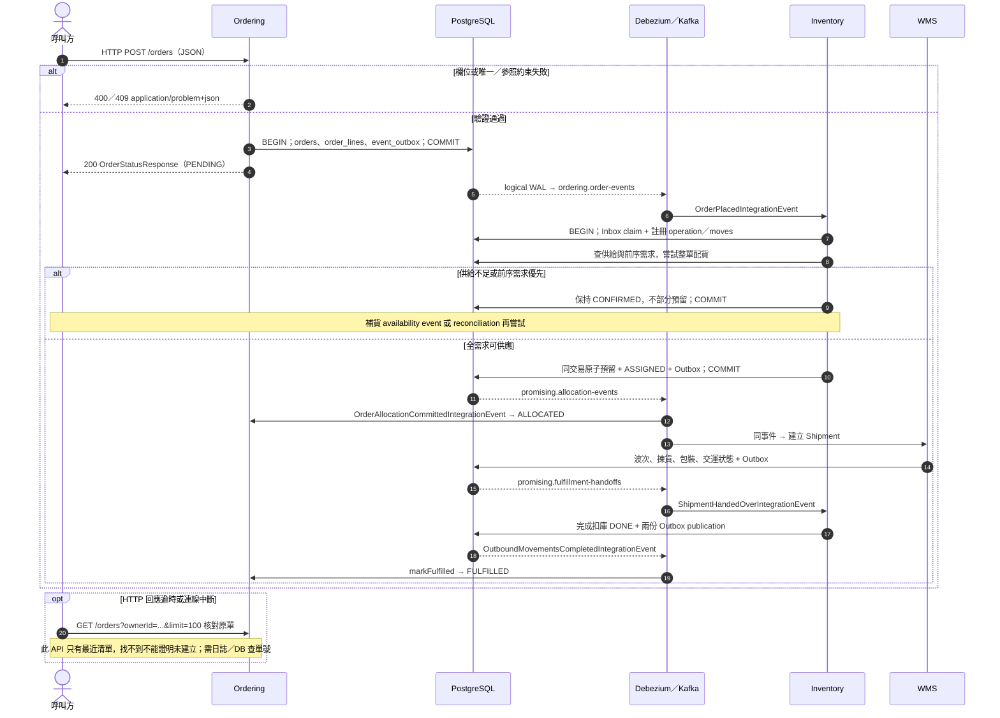
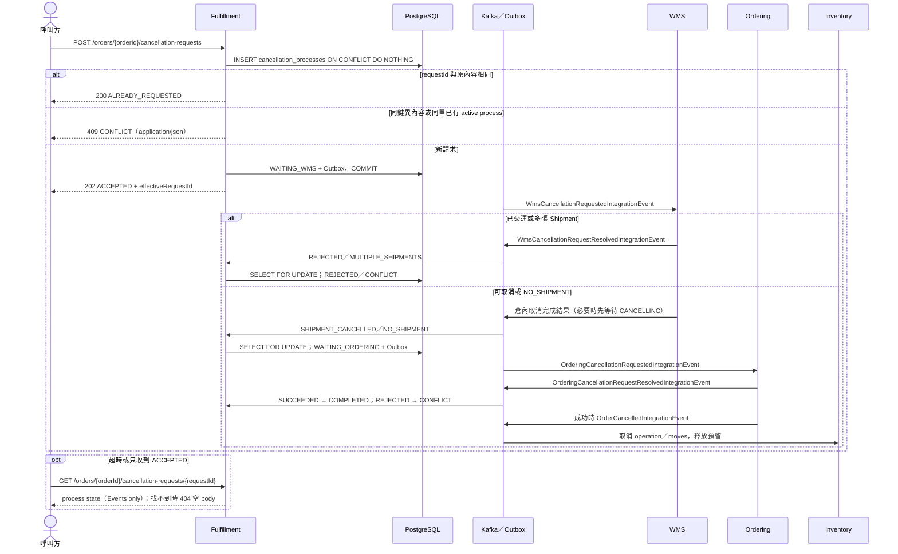
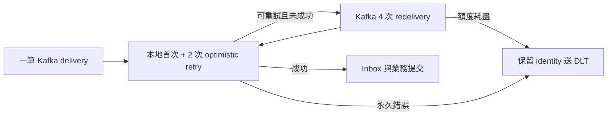

# 06｜整合、交易時序與防呆

## 1 下單與履約時序

| 邊界 | 保證 | 不代表 |
| --- | --- | --- |
| 下單 200 | 訂單與 Outbox 已提交 | 已配貨或已出貨 |
| 收貨 200 | receipt claim、inbound operation／moves／lines、庫存及 availability Outbox 同交易成功 | 等待訂單已完成配貨 |
| 首次配貨交易 | 事件去重、庫存需求登記與首次配貨嘗試在同一交易 | 註冊 CONFIRMED 後先提交、再獨立嘗試首次預留 |
| Consumer | Inbox claim、業務變更、後續 Outbox 同交易；失敗一起回滾 | Kafka 與 DB 分散式 exactly-once transaction |
| Events 多個 subscriber | 各自以 `(subscriber_id, event_id)` 去重 | Ordering 投影與 WMS 同一時刻可見；跨 context 仍為最終一致 |
| 業務事件邊界 | 業務狀態變更先產生內部事件，再轉為對外整合事件 | 業務規則直接依賴訊息傳輸技術 |
| 完成出庫 | 同一出庫完成事實，在交易內產生庫存生命週期與履約兩類事件 | 重複執行出庫扣帳 |

## 2 取消協調時序

| 驅動模式 | 操作差異 |
| --- | --- |
| Events | 持久化 `cancellation_processes`；相同 request 重送回 `ALREADY_REQUESTED`，即使 process 已是終態；process `COMPLETED` 不等於 Inventory 的後續非同步釋放已被觀察到 |
| Temporal | 同一 POST 路徑透過 Workflow 協調；沒有 Events process GET；以履約查詢的 workflow snapshot 核對 |
| Temporal Activity | 呼叫同一業務用例，仍保留 Outbox／Kafka；技術重試與業務拒絕分開 |

## 3 防呆與錯誤矩陣

| 檢查項目 | 觸發端點／邊界 | 檢驗邏輯 | 判定與處置 | HTTP／RFC 9457 code 或實際結果 |
| --- | --- | --- | --- | --- |
| 必填與數量 | `POST /orders` | UUID、日期不可空；字串 `@NotBlank`；lines 非空；quantity > 0；priority 0–100 | 不進入 usecase | 400；type `urn:archone:problem:request-validation`；`errors[].code` 為 `NotNull / NotBlank / NotEmpty / Positive / Min / Max`，無頂層 code |
| 上游時間 | `POST /orders` | `placedAt <= receivedAt + 5 minutes`；可省略、不補系統時間 | 拒絕無效時間 | 400 `INVALID_REQUEST` |
| 重複外部單號 | `POST /orders` | unique `(owner_id, external_order_no)` | 不建立第二單、不回原單 | 409 `DATA_CONFLICT` |
| 貨主／SKU／倉別 | `POST /orders` | DB FK：owner、owner-facility、owner-SKU 組合 | 整筆交易回滾 | 400 `DATA_INTEGRITY_VIOLATION` |
| 訂單不存在 | `GET /orders/{orderId}` | usecase 找不到 Order | 拒絕查詢 | 404 `ORDER_NOT_FOUND` |
| 最近單數量 | `GET /orders` | limit 1–100，預設 20 | 超出即拒絕 | 400 `INVALID_REQUEST` |
| 佇列查詢 | `GET /stock-operations` | state 僅 `CONFIRMED`（不分大小寫）；limit 1–200，預設 100 | 不提供任意狀態搜尋 | 400 `INVALID_REQUEST` |
| 收貨必填 | `POST /stock-receipts` | receiptId、ownerId、facilityId、locationId、日期、SKU、正 quantity | 拒絕不完整命令 | 400 validation；沒有 `expiryDate >= inDate` 或「不得收過期批」檢核，不可自行補寫規則 |
| 收貨庫位 | `POST /stock-receipts` | 指定 location 必須是指定 Facility 的 INTERNAL location | 同交易回滾 receipt claim 與庫存寫入 | 400 `INVALID_REQUEST`（非法庫位對應） |
| 缺失收貨配置 | `POST /stock-receipts` | location 或 INBOUND operation type 找不到 | `IllegalStateException`，交易回滾 | 未由自訂 handler 統一映射，不能宣稱必回 RFC 9457；屬既有錯誤處理缺口 |
| 收貨去重 | `POST /stock-receipts` | 同 receiptId 比對完整 command | 相同回 200；不同不入帳 | 409 `INVENTORY_STOCK_RECEIPT_REQUEST_CONFLICT` |
| 取消內容 | cancellation POST | requestId／requestedAt 必填；reason 非空且至多 512 字元 | 無效請求不受理 | 400 validation／`INVALID_REQUEST` |
| 取消衝突 | cancellation POST | requestId 綁定原 order／time／reason；每單至多一筆 active process | 不建立第二流程 | 409 `OrderCancellationResponse.status=CONFLICT`，**不是 Problem Details** |
| Temporal workflow 不存在 | cancellation POST（temporal） | Workflow 尚未啟動或查無 execution | Adapter 拋 ApplicationConflictException | 409 Problem Details，code=`FULFILLMENT_CANCELLATION_WORKFLOW_UNAVAILABLE`；與取消業務結果 409 格式不同 |
| 取消終態 | cancellation process | 已交運不可逆；WMS 多張 Shipment 不猜測取消對象 | process `REJECTED`／`CONFLICT` | 非同步結果，不是 HTTP Problem；POST 可能已回 202 |
| 過期／貨主／庫位 | allocation | `expiry_date >= today`、scope 一致、可承諾量 > 0 | 過期或異 scope 不可配；缺貨保持 CONFIRMED | 正常等待，沒有錯誤 code |
| 整單與前序需求 | allocation | 全需求可滿足且未侵占優先需求 | 全部預留或全部不預留 | 正常等待；不能自行定義 HTTP 409 |
| 內部契約違反 | HTTP handler | `ContractViolationException` | 記錄 incidentId，不暴露內部細節 | 500 `INTERNAL_ERROR` |
| 跨服務查詢 | fulfillment remote query | HTTP error／連線失敗／timeout | 回報依賴不可用與 incidentId | 502／503 `DOWNSTREAM_SERVICE_ERROR`；504 `DOWNSTREAM_SERVICE_TIMEOUT` |

### 3-1 RFC 9457 現況與差異

標準錯誤回應使用 `application/problem+json`，包含 `type/title/status/detail/instance`；業務錯誤加 `code`，validation 加 `errors: [{field, code, message}]`，內部／下游失敗可加 `incidentId`。[RFC 9457](https://www.rfc-editor.org/rfc/rfc9457.html) 允許 extension members，並未規定必須使用 `invalid_params`。

| 項目 | 合約規則 | 整合注意事項 |
| --- | --- | --- |
| 所有錯誤均為 Problem Details | 保留取消 409 的 `application/json` 與 process GET 404 空 body；OpenAPI 如實描述 | 需修改 Controller 與消費端相容性，不能只改規格 |
| `invalid_params` | 使用 `errors` 欄位 | 需另訂相容遷移，不能宣告已輸出 |
| 字串 Regex | 字串僅要求非空；UUID 使用標準 format | 不加入未存在的 SKU／單號字元限制或 UUIDv4 限制 |

## 4 超時、重試與冪等性

| 層級 | 目前政策 | 操作含義 |
| --- | --- | --- |
| 瀏覽器 client | `fetch`；部分查詢可傳 AbortSignal；未設定統一 timeout 或命令自動重試 | 不能宣稱前端有既定退避或逾時 SLA |
| Microservice read RPC | connect 2 秒、read 5 秒；無應用層 retry | 依 handler 映射 502／503／504 |
| Kafka 本地 optimistic retry | 額外 2 次、間隔 100ms；每次新交易 | 單次 delivery 最多 3 個 optimistic transaction attempts |
| Kafka redelivery | 額外 4 次；初始 1 秒、倍率 2、上限 10 秒，實際退避 1／2／4／8 秒 | optimistic 上限 `(2+1)*(4+1)=15` 次；暫時基礎設施錯誤最多 5 次；沒有設定 jitter |
| 永久錯誤 | mapping、contract、一般業務拒絕與未知錯誤預設不可重試 | DLT 保存原 identity；修正根因後受控重播 |
| Temporal Activity | start-to-close 30 秒；1 秒起、倍率 2、最高 30 秒 | 未設 maximum attempts 或 schedule-to-close；不是總執行上限 30 秒；無顯式 jitter |
| Temporal 不重試 | `IllegalArgumentException`、`ApplicationConflictException`、`DomainConflictException` 精確類名 | 不可把業務拒絕當暫時故障 |
| Reconciliation | 初次 30 秒、fixed delay 900000ms（15 分鐘） | 事件是快速路徑，排程補漏不是固定 15 分鐘完成 SLA |

| 冪等鍵 | 持久化與一致性 | TTL／重送政策 |
| --- | --- | --- |
| 下單 `(ownerId, externalOrderNo)` | `orders` unique；重複回 409 | 沒有 response cache／TTL；保留原單號查證 |
| 收貨 `receiptId` | `stock_receipt_requests` PK；`INSERT ... ON CONFLICT DO NOTHING` + 比對 command，同業務交易 | 無實作清除 TTL；重送相同全部欄位 |
| 取消 `requestId` | Events process PK + active-order partial unique index；比對時間採微秒精度 | 無 TTL；重送相同 order、requestedAt、reason |
| Integration Event | `event_inbox(subscriber_id,event_id)` | 程式庫未自動清除；維運文件建議 Inbox 14 天、Outbox 7 天，必須覆蓋 retention／重播／故障復原窗口 |
| `X-Idempotency-Key` | 未提供此 Header 的去重保證；收貨與取消使用請求內容中的識別碼 | 不因傳送此 Header 就取得防重保證 |
| Redis | 本流程未使用 Redis 作為冪等儲存 | 若未來導入，TTL 至少覆蓋最大重送窗口，且不能取代 DB 的永久業務唯一鍵 |

若未來要求 client exponential backoff with jitter，應另立變更，先定義總 deadline、最大次數與可重送命令；目前沒有可引用的生產預設值。

## 5 事件路由

| Topic | 已定義 contract（v1） |
| --- | --- |
| `ordering.order-events` | `OrderPlacedIntegrationEvent`、`OrderCancelledIntegrationEvent` |
| `inventory.stock-events` | `StockAvailabilityIncreasedIntegrationEvent` |
| `inventory.stock-operation-events` | `StockOperationLifecycleIntegrationEvent` |
| `promising.allocation-events` | `OrderAllocationCommittedIntegrationEvent` |
| `promising.fulfillment-handoffs` | `ShipmentHandedOverIntegrationEvent`、`OutboundMovementsCompletedIntegrationEvent` |
| `fulfillment.cancellation-requests` | `WmsCancellationRequestedIntegrationEvent` |
| `wms.shipment-events` | `ShipmentCancelledIntegrationEvent`、`WmsCancellationRequestResolvedIntegrationEvent` |
| `fulfillment.ordering-cancellation-requests` | `OrderingCancellationRequestedIntegrationEvent` |
| `ordering.cancellation-results` | `OrderingCancellationRequestResolvedIntegrationEvent` |
