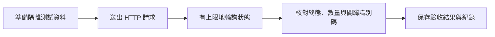

# 08｜UAT 與驗證

## 1 UAT 驗收矩陣（Given–When–Then）

| 案例 ID／目的 | Given | When | Then |
| --- | --- | --- | --- |
| `EVT-FUL-001` 完整履約 | 指定貨主／庫位／SKU 有效在手 20、預留 0 | 下單 3 件 | HTTP 200；最終 Order `FULFILLED`、StockOperation／Move `DONE`、恰一張 Shipment `HANDED_OVER_TO_CARRIER`；on-hand=17、reserved=0；`workflowQueryStatus=NOT_APPLICABLE` |
| `EVT-FUL-003` 整單防部分預留 | A 有 10 件，B 無庫存 | 下 A=5、B=4；之後只補 B=4 | 補貨前 operation `CONFIRMED`、所有 move 無批次、無 Shipment，A 不被部分預留；補 B 後原單自動履約，兩行保持 |
| `CAT-003` 收貨冪等 | 空白隔離 SKU、固定 receiptId | 相同 5 件收貨請求送兩次，再以相同 ID 改為 6 件 | 前兩次 200，on-hand 只有 5；第三次 409 `INVENTORY_STOCK_RECEIPT_REQUEST_CONFLICT`，數量不變 |
| `EVT-CAN-001` 待配取消 | 缺貨 5 件的 Order，operation CONFIRMED，無 Shipment | 固定 requestId 取消、等待完成、原內容重送，再替下一張有效單補 5 件 | 首次 202；Order／operation／move 最終 CANCELLED；process COMPLETED，wmsOutcome NO_SHIPMENT；重送 200 ALREADY_REQUESTED；只喚醒下一張有效單；用別的 orderId 查 process 為 404 空 body |
| `EVT-CAN-002` 已交運拒絕取消 | 2 件訂單已 FULFILLED、Shipment 已交運 | 送出取消請求 | Events 先 202；process 最終 REJECTED、wmsOutcome REJECTED、orderingOutcome null；訂單與 Shipment 保持終態，不回補庫存 |

### 1-1 補充驗收項目

| 驗證維度 | 驗收條件 |
| --- | --- |
| 重複下單 | `CAT-002`：相同 owner 與 externalOrderNo 第二次回 409 DATA_CONFLICT |
| 貨主／庫位隔離 | `EVT-FUL-006 / EVT-FUL-007`：其他貨主或倉別的補貨不能供應目標單 |
| CDC 故障復原 | Connect 暫停期間已提交訂單，恢復後仍由 WAL 追上 |
| 並行守恆 | 並行配貨、釋放及出庫後，預留數量與移動明細一致；失敗交易不保留部分異動 |
| Temporal 等價性 | 正常履約及取消結果符合相同業務規則；流程狀態使用 Temporal 查詢，不使用 Events process GET |
| 防呆回應 | 必填、數量及重複請求按合約拒絕；區分 Problem Details 與取消業務結果 |

## 2 驗收執行方式

### 2-1 環境與資料準備

| 項目 | 要求 |
| --- | --- |
| 測試環境 | 使用隔離環境，分別安排 Events 與 Temporal 模式 |
| 測試資料 | 固定貨主、設施、SKU、單號與請求識別碼，記錄有效日期與初始餘額 |
| 操作 | 按案例送出請求，保存 HTTP 回應及流程關聯識別碼 |
| 非同步結果 | 在約定的觀察期限內查詢終態；逾期未完成須記錄為待查，不直接判定業務拒絕 |
| 復原 | 保留失敗資料與日誌，依 [故障排除手冊](09_TROUBLESHOOTING_RUNBOOK.md) 定位問題 |

### 2-2 結果紀錄

每個案例記錄執行日期、系統版本、驅動模式、初始資料、實際結果及通過／失敗。失敗項目補上差異、追蹤人及複測結果。

本文件列的是驗收條件，不代表所有環境均已完成驗收。正式交付須附本次執行紀錄。
