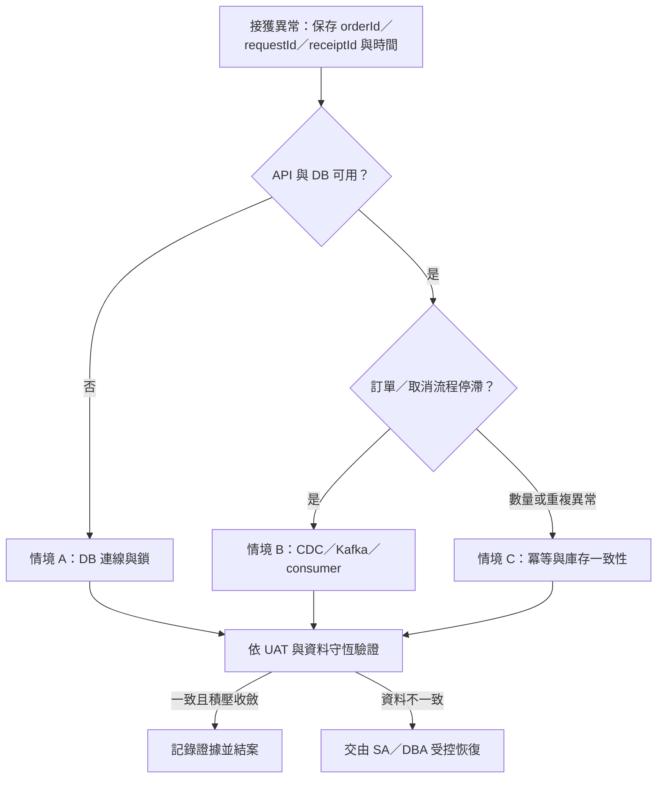
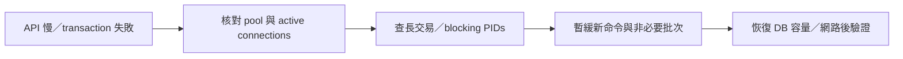
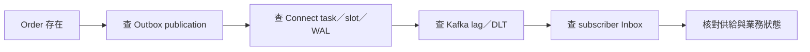
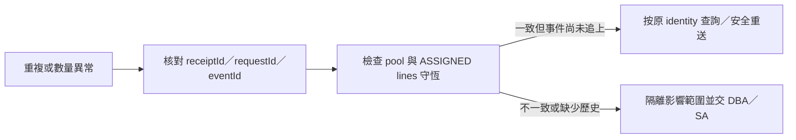

# 09｜五分鐘故障排除手冊

## 1 故障分類



| 優先原則 | 值班執行方式 |
| --- | --- |
| 先辨識部署 | Events demo 使用 2869x，Temporal demo 使用 2879x；production 使用實際配置，不能混用預設連接埠 |
| 先保留 identity | 原始請求、HTTP status、Problem `code`／`incidentId`、Kafka event ID、subscriber ID；不要重建 UUID 掩蓋重送 |
| 停滯不等於缺貨錯誤 | `PENDING`／`CONFIRMED` 可能是正常供給不足或前序需求；202 是受理，不是履約／取消完成 |
| 不以服務健康替代對帳 | readiness 恢復後仍須核對 business state、庫存、consumer lag 與 DLT |
| 五分鐘目標 | 完成初步分類、控制影響並交接；資料恢復時間依故障範圍而定 |

## 2 共用唯讀診斷入口

以下 URL 對應既有 **Events demo**；Temporal 將 28690／28693／28698 改成 28790／28793／28798。正式環境依配置替換，避免對錯環境操作。

```bash
make demo-ps MODE=events
curl --connect-timeout 2 --max-time 8 -fsS http://localhost:28698/actuator/health/readiness
curl --connect-timeout 2 --max-time 8 -fsS http://localhost:28693/connectors/archone-outbox/status
curl --connect-timeout 2 --max-time 8 -fsS 'http://localhost:28690/orders?limit=20'
```

`make demo-logs MODE=events` 會持續跟隨日誌，可用 Ctrl+C 離開。保存片段後用 `rg` 搜尋：

```bash
rg -n 'Allocation optimistic-lock retry exhausted|Contract violation|Downstream service failure|23505|check_violation|HikariPool|Connection is not available' /tmp/archone-incident.log
```

`/tmp/archone-incident.log` 是值班人員匯出的檔名，不是應用固定日誌路徑；日誌關鍵字僅為診斷條件，不宣稱已部署告警。

## 3 情境 A：DB 連線耗盡或鎖等待



| 項目 | 操作 |
| --- | --- |
| 症狀與告警線索 | HTTP timeout、Hikari 取連線逾時、consumer infrastructure retry；production 預設 pool max=10、min idle=2、connection timeout=30000ms、validation timeout=5000ms |
| 0–1 分鐘 | 保存開始時間、最近部署、流量變化；查 readiness、DB 可達性與應用日誌 |
| 1–3 分鐘 | 用具權限的 PostgreSQL 連線執行下列唯讀 SQL，找長交易與 blocking PID；不要把取消長交易當第一步 |
| 3–5 分鐘 | 與業務暫緩新命令或非必要批次；確認 DB／網路／連線容量；由 DBA 處理已識別 blocker，不能盲目放大 pool 或重啟全部服務 |
| 恢復驗證 | 新請求可完成，等待連線下降，consumer lag 開始收斂；不以重試造成第二張單或第二筆收貨 |

```sql
SELECT pid, application_name, state, wait_event_type, wait_event,
       now() - xact_start AS transaction_age, pg_blocking_pids(pid) AS blocking_pids
FROM pg_stat_activity
WHERE datname = current_database()
ORDER BY xact_start NULLS LAST;

SELECT application_name, state, count(*)
FROM pg_stat_activity
WHERE datname = current_database()
GROUP BY application_name, state;
```

## 4 情境 B：已收單但流程停滯／CDC 或 consumer 異常



| 項目 | 操作 |
| --- | --- |
| 症狀與告警線索 | 長時間 PENDING／CONFIRMED、取消 WAITING_WMS／WAITING_ORDERING；Connect task 非 RUNNING、WAL 成長、consumer retry／DLT 增加 |
| 0–1 分鐘 | 先確認是否真缺貨、過期批或前序需求阻擋；核對 owner／location，不把正常等待判成事件遺失 |
| 1–3 分鐘 | 查 connector status、slot、Outbox route，並在 Kafka UI 核對 topic、lag 與 DLT；使用原 event ID 查 Inbox |
| 3–5 分鐘 | 停止 Outbox 清除；確認既有 connector identity、offset 與 slot 後，修復已定位的 broker／網路／task 根因。保留原 connector／slot identity 等待 catch-up |
| 降級策略 | 業務交易仍可持久化 Outbox，但須計算 DB／WAL 剩餘容量並視情況暫緩新命令；不保證當下完成履約 |
| DLT 處理 | 先修原因，按既有 replay 程序單筆驗證，再小批次。保留 event ID、key、original topic、subscriber ID；不直接刪 Inbox 或手造新 event |
| 恢復驗證 | Connect RUNNING、lag 收斂、DLT 不再新增，樣本訂單終態與庫存對得上；Outbox 表保留資料是正常現象，其 row count／最老年齡本身不等於未發送量 |

```sql
SELECT slot_name, active, wal_status,
       pg_size_pretty(pg_wal_lsn_diff(pg_current_wal_lsn(), restart_lsn)) AS retained_wal
FROM pg_replication_slots;

SELECT route, count(*) AS retained_rows, min("timestamp") AS oldest_retained
FROM event_outbox
GROUP BY route;

SELECT state, count(*), min(created_at) AS oldest_created_at
FROM cancellation_processes
WHERE state IN ('WAITING_WMS', 'WAITING_ORDERING')
GROUP BY state;
```

下列 SQL 使用 psql 的 `event_id` 變數；先將事故中保存的真實 event ID 設入變數，再執行。它不是猜測用的範例 UUID。

```sql
SELECT id, type, route, aggregateid, partition_key, "timestamp"
FROM event_outbox WHERE id = :'event_id'::uuid;
SELECT subscriber_id, event_id, event_type, processed_at
FROM event_inbox WHERE event_id = :'event_id'::uuid;
```

| 特殊情況 | 處置 |
| --- | --- |
| slot lost／offset 與備份不一致 | 升級資料恢復事件，進行受控 rebuild 與業務對帳，不能 drop slot 後宣稱正常 |
| Temporal workflow 停滯 | 查 Workflow／Activity 狀態；30 秒僅為單次 Activity timeout，可重試故障會持續退避；不要用 Events process 是否存在判定失敗 |
| Microservice fulfillment query 502／503／504 | 依 `incidentId` 查 `Downstream service failure`；逐一核對 Ordering／Inventory／WMS query 服務，connect 2 秒／read 5 秒，不重送業務命令來修復讀查詢 |

## 5 情境 C：重複收貨、預留衝突或取消後餘額不一致



| 項目 | 操作 |
| --- | --- |
| 症狀與告警線索 | 409 receipt conflict、optimistic retry exhausted、`stock pool reserved quantity must equal assigned move-line quantity` 或使用者回報重複入帳 |
| 0–1 分鐘 | 保存兩份請求，核對是否同 receiptId 卻異內容，或每次點擊都換 ID；409 衝突不可透過換 ID 自動重試 |
| 1–3 分鐘 | 執行下列唯讀守恆 SQL；用原 receiptId 查 `stock_receipt_requests`。同外部單號下單重複以 orders unique 阻擋，不是重複履約證據 |
| 3–5 分鐘 | 暫緩受影響貨主／庫位的命令；若只是暫時並行競爭，觀察既有有界 retry。若資料不一致，交 DBA／SA 保存交易與事件證據，禁止直接修改 reserved 或刪除 claim |
| 恢復驗證 | 同一 receipt 重送不增量；CANCELLED 無 move lines；所有 pool reserved 等於 ASSIGNED 明細；已交運訂單仍 FULFILLED |

```sql
SELECT p.id, p.on_hand_quantity, p.reserved_quantity,
       COALESCE(SUM(CASE WHEN m.state = 'ASSIGNED' THEN l.quantity ELSE 0 END), 0) AS derived_reserved
FROM stock_pools p
LEFT JOIN stock_move_lines l ON l.stock_pool_id = p.id
LEFT JOIN stock_moves m ON m.id = l.move_id
GROUP BY p.id, p.on_hand_quantity, p.reserved_quantity
HAVING p.reserved_quantity < 0
    OR p.reserved_quantity > p.on_hand_quantity
    OR p.reserved_quantity <> COALESCE(SUM(CASE WHEN m.state = 'ASSIGNED' THEN l.quantity ELSE 0 END), 0);

SELECT m.id, m.state, m.demand_quantity, count(l.id) AS line_count,
       COALESCE(sum(l.quantity), 0) AS line_quantity
FROM stock_moves m
LEFT JOIN stock_move_lines l ON l.move_id = m.id
GROUP BY m.id, m.state, m.demand_quantity
HAVING (m.state IN ('CONFIRMED', 'CANCELLED') AND count(l.id) <> 0)
    OR (m.state IN ('ASSIGNED', 'DONE') AND COALESCE(sum(l.quantity), 0) <> m.demand_quantity);
```

兩段查詢均應回零列；大型正式資料庫先限定受影響 scope 或由 DBA 安排，避免全表診斷加重壓力。這是提交後資料的檢查，不應以不同交易的零散讀取判定瞬間差異。

## 6 監控與告警

| 項目 | 說明 |
| --- | --- |
| 告警 | `archone.messaging.producer`、`archone.messaging.consumer`、`archone.messaging.consumer.retry`、`archone.messaging.consumer.dlt` 有觀測名稱；告警門檻與容量需環境實測 |

復原後的業務驗收案例與執行方式見 [UAT 與驗證](08_UAT_AND_VERIFICATION.md)。
